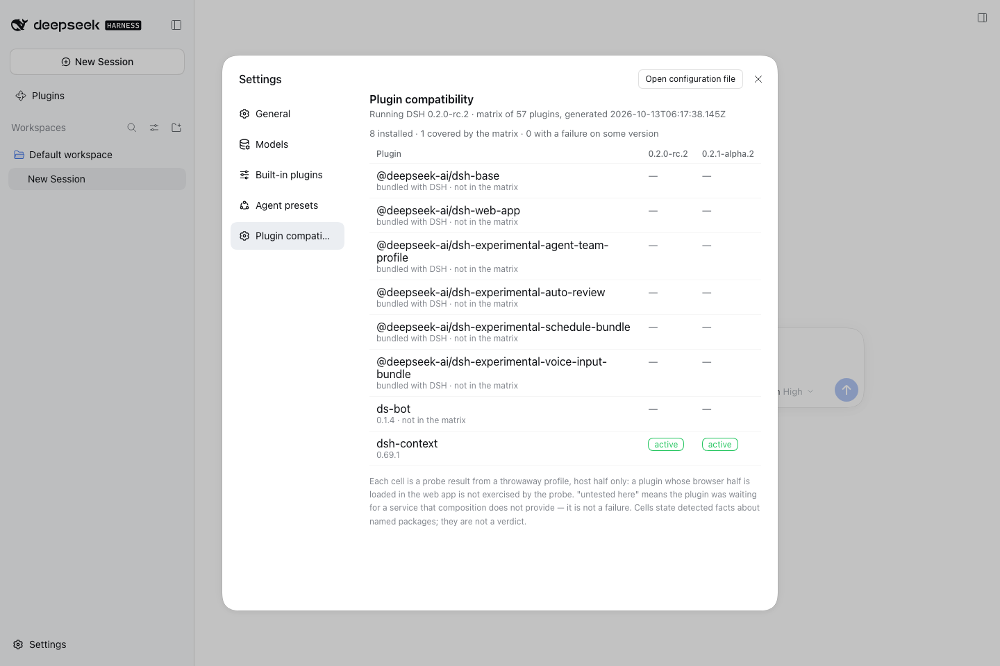
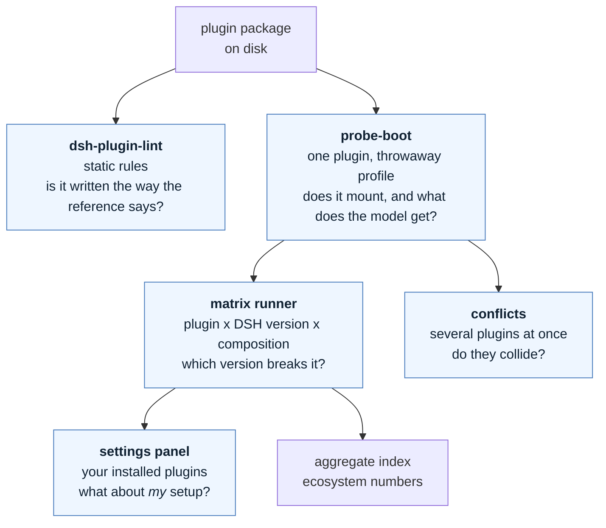
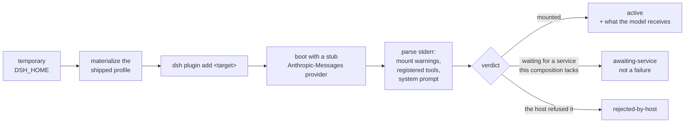

# dsh-plugin-lint

[](https://github.com/shidesheng0218/dsh-plugin-lint/actions/workflows/ci.yml)
[](LICENSE)
[](package.json)
[](package.json)

**Conformance checks and a compatibility matrix for DeepSeek Harness plugins — factual, evidence-backed, zero-config.**

[Rules](#the-rules) · [Probe](#the-probe) · [Matrix](#compatibility-matrix) · [Panel](#the-panel) · [Conflicts](#composition-conflicts) · [中文说明](#中文说明)



*The panel, running in a throwaway web profile: what this profile has installed, and how each plugin fares across DSH versions.*

---

## What this is

Four tools that answer four different questions about a DeepSeek Harness plugin. None of them needs a build step, a config file, or a network connection to run.



Every finding carries a file, a line, an evidence excerpt, and the upstream document the rule encodes.

## What this is not

- **Not a security endorsement.** A clean run means no rule fired, nothing more.
- **Not a replacement for the tools beside it.** Each answers a different question:

| Tool | The question it answers | This project |
| --- | --- | --- |
| [dsh-plugin-doctor](https://github.com/zoahdev/dsh-plugin-doctor) | does the package structure and build hold up? | does not touch builds |
| [dsh-testkit](https://github.com/iiwish/dsh-testkit) | does it install, run and uninstall on a real host? | only checks artifacts on disk |
| [dsh-trust-check](https://github.com/liuwenji007/dsh-trust-check) | what can this plugin touch? | makes no security judgement |
| [dsh-my-guardian](https://github.com/baosfeng/my-dsh-plugins) | what happens after it breaks? | does not recover anything |
| **dsh-plugin-lint** | **is it written the way the reference says, will it survive publishing, and will it survive an upgrade?** | — |

```console
$ npx @shidesheng0218/dsh-plugin-lint .
demo-plugin@1.0.0  11 checks

  E2 error  client bundle factory id does not match the package name
         lib/client.js:2
         factory id "other-name" does not equal the package name "demo-plugin".
         evidence: __ModuleLoader__.load({ id: "other-name" })
         why: the browser module table keys the factory by package name; a mismatch
              leaves the registration unreachable at runtime.
         doc: dsh plugin-development / references/ui-plugin.md

  W1 warn   loads a Harness Client package as a module
         lib/client.js:12
         loads "@deepseek-ai/dsh-client-ui-primitives" from the browser module table.
         why: the reference advises copying the primitive instead — these packages
              change without notice and a throwing component blanks the slot. Official
              first-party bundles do the same, so treat this as a coupling risk to
              watch at upgrade time, not as a defect.

  1 error · 1 warn · 0 info
```

## The rules

Levels are assigned by **how reliably a rule can decide**, not by how bad the pattern sounds. A rule that cannot decide reliably does not get to be an error.

**error** — mechanically decidable, never observed in the official packages

| Rule | What it catches |
| --- | --- |
| E1 | `session.append("type", …)` with a type outside the Harness event catalog (45 types, harvested from the official packages) |
| E2 | client bundle factory id ≠ package name (the registration silently never resolves) |
| E3 | `main` / `exports["./client"]` / `dsh.bundle.patch` / `icon` points at a missing file |
| E4 | `dsh.client` declared with no resolvable `./client` export |
| E5 | `files[]` omits an artifact the manifest depends on — the "works locally, broken after publish" bug |

**warn** — documented risk patterns, evidence required

| Rule | What it catches |
| --- | --- |
| W1 | loads a `@deepseek-ai/dsh-client-*` package as a module (first-party packages exempt: they ship with the module table) |
| W2 | subscribes to `session/event` and rescans the log inside the listener instead of folding through `ctx.sessionProjections` |
| I3 | locale metadata exists but is not exported or published |

**info** — review hints and metadata completeness

| Rule | What it catches |
| --- | --- |
| I1 | no `dsh.compatibility.dshReleases` (or it omits the running DSH version, with `--dsh-version`) |
| I2 | no `icon`, or no `meta` title/description in `locale/<lang>.json` |
| W3 | a timer that looks unowned (brace depth is approximate on bundled output) |

Rules the first draft had, and why they are gone: "a waterfall listener must call `next()`" (real plugins reject deliberately, and re-enter `ctx.llm.stream()` on purpose), "never listen to `system-prompt/assemble`" (the official packages do, four times), "never subscribe to `session/event`" (the reference forbids *rescanning*, not subscribing). See [docs/06](docs/06-detailed-design.md).

## The probe

Static analysis reads code. The probe reads **behaviour**: it boots a real DSH in a throwaway home with one plugin installed and records what the host did with it.



Two details make it work, and both were learned the hard way:

- **The success sentinel is a missing credential.** The throwaway home has no API key, so a plugin that mounted successfully ends in `MISSING_CREDENTIAL`. That is the signal.
- **The exit code is never the signal.** A mount failure is a warning and the process still exits 0.

```bash
node scripts/probe-boot.mjs dsh-mnemon --tools
#   active  (3732 ms)
#   tools 24 -> 41  +17: mnemon_remember, mnemon_recall, mnemon_forget, ...
#   system prompt 2640 -> 7153 chars
```

See [docs/11](docs/11-m4-capability-probe.md).

## Why this exists

Measured on 2026-10-13 against the top 40 published community plugins and an installed DSH 0.2.0-rc.2:

| Observation | Result |
| --- | --- |
| plugins whose `peerDependencies` couple them to a Harness Client package | **16 / 40 (40%)** |
| plugins declaring `dsh.compatibility.dshReleases` | **5 / 40 (13%)** |
| plugins declaring an `icon` | 16 / 40 (40%) |

The ecosystem has 4,508 catalogued plugins and adds roughly a thousand a month. Upgrade breakage is a product category of its own (three tools sell the *recovery*), but nothing was checking the code against the documented practices.

### Measured with this tool

| Run | Result |
| --- | --- |
| 80 official `@deepseek-ai/*` packages (zero-false-positive baseline) | **0 error · 0 warn** · 239 info |
| Top 100 published community plugins | **1 error · 86 warn** · 223 info |
| — of which couple to a Harness Client package | **62%** |
| — of which declare no DSH compatibility range | **87%** |

The error rules did not fire on any published plugin. They are insurance against rare, fatal mistakes — the daily value is the coupling inventory (W1) and declaration completeness (I1/I2), which nearly every plugin is missing something on. See [docs/07](docs/07-m1-results.md).

## Usage

```bash
npx @shidesheng0218/dsh-plugin-lint .            # lint the package in the current directory
npx @shidesheng0218/dsh-plugin-lint ./plugins/a ./plugins/b
npx @shidesheng0218/dsh-plugin-lint . --json     # machine-readable report
npx @shidesheng0218/dsh-plugin-lint . --sarif    # SARIF 2.1.0 for code scanning
npx @shidesheng0218/dsh-plugin-lint . --dsh-version 0.2.0-rc.2
npx @shidesheng0218/dsh-plugin-lint . --exit-code  # exit 1 when an error-level finding is present
```

Exit codes: `0` ok · `1` errors found with `--exit-code` · `2` the run failed.

## Compatibility matrix

The probe also runs as a grid: one cell per plugin version × DSH version × composition.

```bash
node scripts/matrix/run.mjs --targets matrix/targets-top50.json --concurrency 4
node scripts/matrix/site.mjs
```

Measured on 2026-10-13 over **228 cells** (57 plugins, two DSH versions, headless and web):

| Status | Cells | Meaning |
| --- | --- | --- |
| active | 136 | the host half mounted |
| awaiting-service | 31 | this composition does not provide a service it waits for |
| rejected-by-host | 30 | **the host itself refused the install** |
| install-failed | 3 | network (native package download) |

**17 of 57 plugins get a worse verdict on the newer DSH version and none get better**; 14 are the host refusing the install outright, and the largest system-prompt growth observed was 10,862 characters. Aggregate numbers: [docs/09](docs/09-ecosystem-measurements.md).

Plugin authors can run the same probe from their own CI — [docs/15](docs/15-federation.md):

```yaml
- uses: shidesheng0218/dsh-plugin-lint/.github/actions/probe@v1
  with:
    target: .
    dsh-versions: 0.2.0-rc.2,0.2.1-alpha.2
```

Self-reported cells are never presented as ours: they are sampled, re-run, and either promoted to `verified` or marked `disputed` with both verdicts kept.

## Composition conflicts

A plugin that mounts alone can still collide with another. `conflicts.mjs` reads the tool names already recorded in the matrix cells, groups them by owner, and then verifies a candidate by installing the pair into **one** profile.

The sampled ecosystem had no collisions (16 plugins, 118 tool names), so two fixtures claim the same tool name on purpose. Measured result:

| Stage | Result |
| --- | --- |
| each alone | both `active`, +1 tool each |
| **installed together** | **the later one never activates** |

```text
tool-beta: Error: tool "collide_probe" is already registered
  (for a per-agent variant, register through that agent's `agent.ctx` instead)
```

It is not "the last one wins" — the later plugin is discarded whole. And because a failed mount is only a warning with exit code 0, a user can run two clashing plugins with one of them silently doing nothing. See [docs/18](docs/18-composition-conflicts.md).

## The panel

[`panel/`](panel/) is a real DSH plugin: a settings section listing what this profile has installed and how each plugin fares across DSH versions, read from the matrix snapshot. The screenshot at the top of this file is it, captured by [`scripts/screenshot-panel.mjs`](scripts/screenshot-panel.mjs) in a throwaway web profile.

```bash
node scripts/matrix/bundle-panel-data.mjs          # snapshot the matrix into the package
dsh plugin --profile <profile> add <absolute path to panel/>
```

It mounts on both pinned DSH versions in both compositions, and it passes this project's own linter with zero findings — only `react` comes from the browser module table, no Harness Client package is imported, and colours use `--dsw-alias-*` tokens with fallbacks.

Visual verification caught two bugs a code review had not: the page said "Running DSH unknown" because `import.meta.resolve` cannot see the harness from inside a profile, and it called first-party bundles "not installed" although the dsh installation provides them. Both are fixed, and [docs/16](docs/16-m5-panel.md) records what was checked.

## Data policy

This repository ships the **tool**, not the results. Any output that names a package — `reports/`, `notify/`, `matrix/cells/`, `matrix/index/`, `site/`, and the panel's matrix snapshot — is generated locally and untracked.

Two reasons, and they point the same way:

1. **Naming a package is a claim about someone's work.** Doing it well means contacting that maintainer first, and that is a decision, not a default.
2. **Verified data is only meaningful for the environment that produced it.** Whoever runs the probe gets their own answer; a snapshot from our machine is not evidence about theirs.

The aggregate numbers are published, because they describe the ecosystem rather than any one maintainer: see [docs/09](docs/09-ecosystem-measurements.md).

## Reports

```bash
node scripts/build-report.mjs --top 100              # ecosystem coupling & declaration report
node scripts/build-contact-list.mjs reports/<date>   # who to notify before publishing
node scripts/build-notification-pack.mjs             # notify/NOTIFICATIONS.md + one message per package
```

Every report names packages, so the project follows one rule (ADR D-001): **name the package, state only what was detected, cite the source, and notify the maintainer first.** See [docs/08](docs/08-author-notification.md).

## Development

```bash
npm test                 # unit tests for every rule (node:test, no dependencies)
npm run e2e:official     # zero-false-positive baseline against official packages
```

`npm run e2e:official` is the acceptance test that matters: it lints the official `@deepseek-ai/*` packages, which are the reference implementation of the documented practices. **Any error-level finding on them is a bug in a rule, not in the package.** Extract the fixtures first:

```bash
node scripts/extract-official-fixtures.mjs        # reads an installed DSH (asar)
node scripts/extract-official-fixtures.mjs --limit 80
```

## License

Apache-2.0. See [NOTICE](NOTICE) for the data derived from DeepSeek Harness (MIT).

---

## 中文说明

**给 DeepSeek Harness 插件做合规体检与兼容性实测的工具链：只陈述检测到的事实，每条结论都带文件、行号、证据和官方出处。**

**四件事，四个问题**：

| 工具 | 回答的问题 |
| --- | --- |
| `dsh-plugin-lint` | 代码写得符不符合官方规范、发布出去会不会缺文件 |
| `probe-boot` | 这个插件在这个 DSH 版本上能不能挂载、给了模型什么 |
| 矩阵跑批 | 哪个版本会让它坏掉 |
| `conflicts` | 几个插件装在一起会不会互相顶掉 |

**它不是什么**：不是安全背书（干净≠安全）；也不替代旁边那几个工具——doctor 管包结构、testkit 管真实宿主生命周期、trust-check 管能力披露、my-guardian 管崩了之后怎么办。

**规则分级按"能不能可靠判定"来定，而不是按听起来多严重**：error 级必须机器可判且官方包里从不出现；warn 级是官方文档点名的风险写法，必须附证据；info 级是提示与元数据完整性。

**实测数据（2026-10-13）**：Top 40 社区插件里，**40% 依赖了官方的 Client 包**、**只有 13% 声明了兼容的 DSH 版本**；228 格矩阵里 **57 个插件中有 17 个在新版上结论变差，没有一个变好**。

**两个只有实测才能知道的坑**：宿主拒绝安装时只是 warning、退出码仍为 0（所以退出码永远不是信号）；两个插件抢同一个工具名时，**后注册的那个整个插件报废**，而不是覆盖。

**数据政策**：仓库只发工具，不发点名结果——凡是会点名具体包的数据都在本地生成、不进版本库。生态聚合数字照常发布。

初版规则里有三条被实测否掉（官方包自己就在监听 `system-prompt/assemble`；真实插件会故意不调 `next()`），详见 [详细设计](docs/06-detailed-design.md)。
