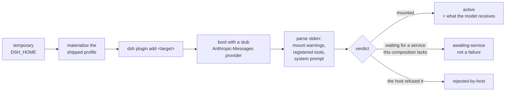

# dsh-plugin-lint

[](https://www.npmjs.com/package/@shidesheng0218/dsh-plugin-lint)
[](https://github.com/shidesheng0218/dsh-plugin-lint/actions/workflows/ci.yml)
[](LICENSE)
[](package.json)
[](package.json)

**Conformance checks and a compatibility matrix for DeepSeek Harness plugins — factual, evidence-backed, zero-config.**

[Rules](#the-rules) · [Probe](#the-probe) · [Matrix](#the-compatibility-matrix) · [Panel](#the-panel) · [Conflicts](#composition-conflicts) · [Federation](#federation) · [中文](#中文)


*The panel, running in a throwaway web profile: what this profile has installed, and how each plugin fares across DSH versions.*

---

## Why this exists

The ecosystem has 4,508 catalogued plugins and adds roughly a thousand a month. Upgrade breakage is a product category of its own (three tools sell the *recovery*), but nothing was checking the code against the documented practices.

Measured on 2026-10-13 against the top 40 published community plugins and an installed DSH 0.2.0-rc.2:

| Observation | Result |
| --- | --- |
| plugins whose `peerDependencies` couple them to a Harness Client package | **16 / 40 (40%)** |
| plugins declaring `dsh.compatibility.dshReleases` | **5 / 40 (13%)** |
| plugins declaring an `icon` | 16 / 40 (40%) |

These are not style issues. A coupling to `@deepseek-ai/dsh-client-*` breaks when the host updates those packages without notice. A missing compatibility declaration means upgrade day is untested. A `files[]` gap passes local testing and only fails in the published tarball.

## What this is

Four tools that answer four different questions about a DeepSeek Harness plugin. None of them needs a build step, a config file, or a network connection to run.


Every finding carries a file, a line, an evidence excerpt, and the upstream document the rule encodes.

## What this is not

- **Not a security endorsement.** A clean run means no rule fired, nothing more.
- **Not a replacement for the tools beside it.** Each answers a different question:

| Tool | The question it answers | This project |
| --- | --- | --- |
| [dsh-plugin-doctor](https://github.com/zoahdev/dsh-plugin-doctor) | does the package structure and build hold up? | does not touch builds |
| [dsh-testkit](https://github.com/iiwish/dsh-testkit) | does it install, run and uninstall on a real host? | only checks artifacts on disk |
| [dsh-trust-check](https://github.com/liuwenji007/dsh-trust-check) | what can this plugin touch? | makes no security judgement |
| [dsh-my-guardian](https://github.com/baosfeng/my-dsh-plugins) | what happens after it breaks? | does not recover anything |
| **dsh-plugin-lint** | **is it written the way the reference says, will it survive publishing, and will it survive an upgrade?** | — |

```console
$ npx @shidesheng0218/dsh-plugin-lint .
demo-plugin@1.0.0  9 checks

  E2 error  client bundle factory id matches nothing the loader can ask for
         lib/client.js:2
         factory id "other-name" is neither the package name "demo-plugin" nor a row name in the bundle patch.
         evidence: __ModuleLoader__.load({ id: "other-name" })
         why: the browser module table keys the factory by the id it asks for and the loader
              throws when a bundle registers another one, leaving the client half unreachable.
         doc: dsh plugin-development / references/ui-plugin.md

  W1 warn   couples the plugin to a Harness Client package
         lib/client.js:12
         loads 1 Harness Client package from the browser module table: @deepseek-ai/dsh-client-ui-primitives.
         why: the reference advises copying the primitive instead — these packages change without
              notice and a throwing component blanks the slot. Official first-party bundles do
              the same, so treat this as a coupling risk to watch at upgrade time, not a defect.

  1 error · 1 warn · 0 info
```

## The rules

Levels are assigned by **how reliably a rule can decide**, not by how bad the pattern sounds. A rule that cannot decide reliably does not get to be an error.

**error** — mechanically decidable, never observed in the official packages

| Rule | What it catches |
| --- | --- |
| E1 | `session.append("type", …)` with a type outside the Harness event catalog (45 types, harvested from the official packages) |
| E2 | client bundle factory id ≠ anything the loader can ask for (the registration silently never resolves) |
| E3 | `main` / `exports["./client"]` / `dsh.bundle.patch` / `icon` points at a missing file |
| E4 | `dsh.client` declared with no resolvable `./client` export |
| E5 | `files[]` omits an artifact the manifest depends on — the "works locally, broken after publish" bug |

**warn** — documented risk patterns, evidence required

| Rule | What it catches |
| --- | --- |
| W1 | loads a `@deepseek-ai/dsh-client-*` package as a module (first-party packages exempt: they ship with the module table) |
| W2 | subscribes to `session/event` and rescans the log inside the listener instead of folding through `ctx.sessionProjections` |
| I3 | locale metadata exists but is not exported or published |

**info** — review hints and metadata completeness

| Rule | What it catches |
| --- | --- |
| I1 | no `dsh.compatibility.dshReleases` (or it omits the running DSH version, with `--dsh-version`) |
| I2 | no `icon`, or no `meta` title/description in `locale/<lang>.json` |
| W3 | a timer that looks unowned (brace depth is approximate on bundled output, which is why this is a hint and not a warning) |

Rules the first draft had, and why they are gone: "a waterfall listener must call `next()`" (real plugins reject deliberately, and re-enter `ctx.llm.stream()` on purpose), "never listen to `system-prompt/assemble`" (the official packages do, four times), "never subscribe to `session/event`" (the reference forbids *rescanning*, not subscribing). See [docs/06](docs/06-detailed-design.md).

W1 encodes this passage from the reference, verbatim:

> Do not `require('@deepseek-ai/dsh-client-ui-primitives')` or load any other Harness Client package as a module … copy markup, CSS, and behavior from the primitive into the plugin.
> — `dsh plugin-development / references/practices.md`

Measured on 2026-10-13: 62% of the Top 100 published plugins load at least one of these packages, and the most loaded one (ui-primitives) is imported by 71 plugins.

### Measured with this tool

| Run | Result |
| --- | --- |
| 80 official `@deepseek-ai/*` packages (zero-false-positive baseline) | **0 error · 0 warn** · 239 info |
| Top 100 published community plugins | **1 error · 86 warn** · 223 info |
| — of which couple to a Harness Client package | **62%** |
| — of which declare no DSH compatibility range | **87%** |

The error rules did not fire on any published plugin. They are insurance against rare, fatal mistakes — the daily value is the coupling inventory (W1) and declaration completeness (I1/I2), which nearly every plugin is missing something on. See [docs/07](docs/07-m1-results.md).

## The probe

Static analysis reads code. The probe reads **behaviour**: it boots a real DSH in a throwaway home with one plugin installed and records what the host did with it.



Two details make it work, and both were learned the hard way:

- **The success sentinel is a missing credential.** The throwaway home has no API key, so a plugin that mounted successfully ends in `MISSING_CREDENTIAL`. That is the signal.
- **The exit code is never the signal.** A mount failure is a warning and the process still exits 0.

```bash
node scripts/probe-boot.mjs dsh-mnemon --tools
#   active  (3732 ms)
#   tools 24 -> 41  +17: mnemon_remember, mnemon_recall, mnemon_forget, ...
#   system prompt 2640 -> 7153 chars
```

See [docs/11](docs/11-m4-capability-probe.md).

## Usage

```bash
npx @shidesheng0218/dsh-plugin-lint .            # lint the package in the current directory
npx @shidesheng0218/dsh-plugin-lint ./plugins/a ./plugins/b
npx @shidesheng0218/dsh-plugin-lint . --json     # machine-readable report
npx @shidesheng0218/dsh-plugin-lint . --sarif    # SARIF 2.1.0 for code scanning
npx @shidesheng0218/dsh-plugin-lint . --dsh-version 0.2.0-rc.2
npx @shidesheng0218/dsh-plugin-lint . --exit-code  # exit 1 when an error-level finding is present
```

Exit codes: `0` ok · `1` errors found with `--exit-code` · `2` the run failed.

Commands in this README that start with `node scripts/` run from a **checkout of this repository** — the matrix runner, the upgrade preview, and the report builders read files the npm package does not ship. The npm package ships the linter CLI, the probe (also available as `dsh-plugin-probe`), and the library.

## The compatibility matrix

The probe also runs as a grid: one cell per plugin version × DSH version × composition.

```bash
node scripts/matrix/run.mjs --targets matrix/targets-top50.json --concurrency 4
node scripts/matrix/site.mjs
```

Measured on 2026-10-13 over **228 cells** (57 plugins, two DSH versions, headless and web):

| Status | Cells | Meaning |
| --- | --- | --- |
| active | 136 | the host half mounted |
| awaiting-service | 31 | this composition does not provide a service it waits for |
| rejected-by-host | 30 | **the host itself refused the install** |
| install-failed | 3 | network (native package download) |

**17 of 57 plugins get a worse verdict on the newer DSH version and none get better**; 14 are the host refusing the install outright, and the largest system-prompt growth observed was 10,862 characters. Aggregate numbers: [docs/09](docs/09-ecosystem-measurements.md).

### Upgrade preview

The matrix answers "which version breaks this plugin"; the preview answers the question a user actually has: **should this profile upgrade?** It reads the profile's installed bundles, joins them against the matrix, and reports what changes on the target version:

```bash
node scripts/upgrade-preview.mjs ~/.dsh/profiles/default
```

```text
Upgrade preview: 0.2.0-rc.2 -> 0.2.1-alpha.2
Profile ~/.dsh/profiles/default · 8 installed (6 community, 2 first-party)

  2 worse · 0 better · 3 unchanged · 1 not covered by the matrix

  ✗  @michengai/dsh-archive-manager
      0.2.0-rc.2: active   ->   0.2.1-alpha.2: rejected-by-host
```

A plugin the matrix does not cover is reported as unknown, not as a verdict. First-party bundles are counted but not previewed — the matrix says nothing about them.

## Composition conflicts

A plugin that mounts alone can still collide with another. `conflicts.mjs` scans two dimensions: the tool names recorded in the matrix cells (what the host registered), and the slot names each plugin's client bundle declares (what the code claims). A name claimed by two plugins in either dimension is a candidate, verified by installing the pair into **one** profile.

Measured on 2026-10-13 over the sampled ecosystem (16 plugins):

| Dimension | Collisions found |
| --- | --- |
| tool names (118 distinct) | **0** |
| slot names (37 distinct) | **10** — `settings.section` alone is claimed by three plugins |

The tool-name result is a clean bill; the slot result is not. Two fixtures claim the same tool name on purpose to show what a collision looks like:

| Stage | Result |
| --- | --- |
| each alone | both `active`, +1 tool each |
| **installed together** | **the later one never activates** |

```text
tool-beta: Error: tool "collide_probe" is already registered
  (for a per-agent variant, register through that agent's `agent.ctx` instead)
```

It is not "the last one wins" — the later plugin is discarded whole. And because a failed mount is only a warning with exit code 0, a user can run two clashing plugins with one of them silently doing nothing. See [docs/18](docs/18-composition-conflicts.md).

## The panel

[`panel/`](panel/) is a real DSH plugin: a settings section listing what this profile has installed, how each plugin fares across DSH versions, and — below the table — the ecosystem picture: aggregate counts per version, never a package name. The screenshot at the top of this file is it, captured by [`scripts/screenshot-panel.mjs`](scripts/screenshot-panel.mjs) in a throwaway web profile.

A profile with no community plugins still shows the matrix overview: 57 plugins probed across 2 DSH versions, and the bars make the upgrade story visible at a glance (80% mounted on 0.2.0-rc.2, 57% on 0.2.1-alpha.2).

```bash
node scripts/matrix/bundle-panel-data.mjs          # snapshot the matrix into the package
dsh plugin --profile <profile> add <absolute path to panel/>
```

It mounts on both pinned DSH versions in both compositions, and it passes this project's own linter with zero findings — only `react` comes from the browser module table, no Harness Client package is imported, and colours use `--dsw-alias-*` tokens with fallbacks.

Visual verification caught two bugs a code review had not: the page said "Running DSH unknown" because `import.meta.resolve` cannot see the harness from inside a profile, and it called first-party bundles "not installed" although the dsh installation provides them. Both are fixed, and [docs/16](docs/16-m5-panel.md) records what was checked.

## Federation

Plugin authors can run the same probe from their own CI — [docs/15](docs/15-federation.md):

```yaml
- uses: shidesheng0218/dsh-plugin-lint/.github/actions/probe@v1
  with:
    target: .
    dsh-versions: 0.2.0-rc.2,0.2.1-alpha.2
```

Self-reported cells are never presented as ours: they are sampled, re-run, and either promoted to `verified` or marked `disputed` with both verdicts kept. A disagreement is never hidden — that is the property the rest of the matrix depends on.

| Trust level | Source | Meaning |
| --- | --- | --- |
| `verified` ✅ | our runs, or a sampled re-run that matched | we stand behind "this is what we observed" |
| `self-reported` 🟡 | author's CI, not yet re-run | represents only what the author reported |
| `disputed` ⚠️ | re-run disagreed | both verdicts stay in the file; the difference is public |
| `stale` ⏳ | older than 30 days, or a newer DSH exists | the verdict may have expired |

## Methodology

Every round of wider sampling exposed a systematic misjudgement in the measuring, not the measured. Each correction is now load-bearing:

| Round | Scale | What it exposed | The fix |
| --- | --- | --- | --- |
| smoke | 22 cells | "waiting for a service" was scored as failure | renamed `awaiting-service` + added the web composition |
| Top 50 | 200 cells | exit codes were trusted as install results (23 of 26 "failures" had in fact installed) | verify the artifact: did the profile's package.json change? |
| rule design | — | 3 of the first 12 rules would have flagged the official packages | rules re-graded by decidability; the official packages are the zero-false-positive baseline |

A small sample cannot find systematic bias, so widening the sample is itself a verification step. No rule and no verdict criterion ships until it has run on real data. See [docs/09](docs/09-ecosystem-measurements.md).

## Data policy

This repository ships the **tool**, not the results. Any output that names a package — `reports/`, `notify/`, `matrix/cells/`, `matrix/index/`, `site/`, and the panel's matrix snapshot — is generated locally and untracked.

Two reasons, and they point the same way:

1. **Naming a package is a claim about someone's work.** Doing it well means contacting that maintainer first, and that is a decision, not a default.
2. **Verified data is only meaningful for the environment that produced it.** Whoever runs the probe gets their own answer; a snapshot from our machine is not evidence about theirs.

The aggregate numbers are published, because they describe the ecosystem rather than any one maintainer: see [docs/09](docs/09-ecosystem-measurements.md).

## Reports

```bash
node scripts/build-report.mjs --top 100              # ecosystem coupling & declaration report
node scripts/build-contact-list.mjs reports/<date>   # who to notify before publishing
node scripts/build-notification-pack.mjs             # notify/NOTIFICATIONS.md + one message per package
```

Every report names packages, so the project follows one rule (ADR D-001): **name the package, state only what was detected, cite the source, and notify the maintainer first.** See [docs/08](docs/08-author-notification.md).

## Development

```bash
npm test                 # unit tests for every rule (node:test, no dependencies)
npm run e2e:official     # zero-false-positive baseline against official packages
```

`npm run e2e:official` is the acceptance test that matters: it lints the official `@deepseek-ai/*` packages, which are the reference implementation of the documented practices. **Any error-level finding on them is a bug in a rule, not in the package.** Extract the fixtures first:

```bash
node scripts/extract-official-fixtures.mjs        # reads an installed DSH (asar)
node scripts/extract-official-fixtures.mjs --limit 80
```

## License

Apache-2.0. See [NOTICE](NOTICE) for the data derived from DeepSeek Harness (MIT).

---

## 中文

**给 DeepSeek Harness 插件做合规体检与兼容性实测的工具链：只陈述检测到的事实，每条结论都带文件、行号、证据和官方出处。**

四个工具，各回答一个问题：

| 工具 | 回答的问题 |
| --- | --- |
| `dsh-plugin-lint` | 代码写得符不符合官方规范、发布出去会不会缺文件 |
| `probe-boot` | 这个插件在这个 DSH 版本上能不能挂载、给了模型什么 |
| 矩阵跑批 | 哪个版本会让它坏掉 |
| `conflicts` | 几个插件装在一起会不会互相顶掉 |

它不是什么：不是安全背书（干净的运行只代表没有规则命中）；也不替代旁边几个工具——doctor 管包结构、testkit 管真实宿主生命周期、trust-check 管能力披露、my-guardian 管崩了之后怎么办。

### 为什么需要它

生态已有 4,508 个收录插件、月增近千，但"代码写得对不对、升级后还能不能用"此前没有工具回答。2026-10-13 对已发布插件的实测：

| 观测 | 结果 |
| --- | --- |
| peerDependencies 耦合了官方 Harness Client 包（Top 40） | **16 / 40（40%）** |
| 声明了 `dsh.compatibility.dshReleases`（Top 40） | 5 / 40（13%） |
| 从浏览器模块表加载官方 Client 包（Top 100） | **62%** |
| 没有声明任何 DSH 兼容范围（Top 100） | **87%** |

这些不是代码风格问题。耦合了 `@deepseek-ai/dsh-client-*` 的插件，在宿主无通知更新这些包时会坏；没声明兼容范围的插件，升级那天就是未测试状态；`files[]` 漏掉产物的问题本地测试发现不了，发布后才出现。

W1 规则对应的官方文档原文：

> Do not `require('@deepseek-ai/dsh-client-ui-primitives')` or load any other Harness Client package as a module … copy markup, CSS, and behavior from the primitive into the plugin.
> — `dsh plugin-development / references/practices.md`

被加载最多的官方 Client 包是 ui-primitives，有 71 个插件引用它。

### 规则分级

按"能不能可靠判定"分级，而不是按听起来多严重：error 级必须机器可判、且在官方包里从不出现；warn 级是官方文档点名的风险写法，必须附证据；info 级是提示与元数据完整性。判不准的规则不配对插件下结论——判不准就降级，或者删掉。初版 12 条规则里有 3 条按字面实现会误报官方包，已按这个原则处理，详见 [详细设计](docs/06-detailed-design.md)。

验收基线是 80 个官方 `@deepseek-ai/*` 包 **0 error · 0 warn**：官方包是文档规范的参考实现，error 级规则命中官方包，先假定是规则的 bug。

### 探针

静态分析读代码，探针读**行为**：在一次性的 DSH_HOME 里物化官方 profile，装入一个插件，用本地桩 provider 接住宿真实发出的请求，从请求体里读出注册的工具清单和系统提示词长度。不需要 API key。

两个只有实测才能发现的坑：

- **退出码永远不是信号。** 挂载失败只是 warning，进程退出码仍为 0——所以探针解析 stderr。同理，安装结果也不能信退出码：200 格跑批里 26 个"安装失败"有 23 个其实装成功了，判据改为校验产物（profile 的 package.json 是否变化）。
- **成功的哨兵是一个缺失的凭据。** 一次性环境里没有 API key，所以挂载成功的插件会以 `MISSING_CREDENTIAL` 结束。这就是信号。

### 兼容性矩阵

探针按网格跑：一格 = 一个插件版本 × 一个 DSH 版本 × 一种组合。228 格（57 个插件、两个 DSH 版本、headless 和 web 两种组合）的实测结果：

| 状态 | 格数 | 含义 |
| --- | --- | --- |
| active | 136 | host 半边挂载成功 |
| awaiting-service | 31 | 该组合未提供它等待的服务（不是失败） |
| rejected-by-host | 30 | 宿主自己拒绝安装 |
| install-failed | 3 | 网络问题 |

**57 个插件里 17 个在新版 DSH 上结论变差，没有一个变好**；14 个是宿主直接拒绝安装。观测到的最大系统提示词增长是 10,862 字符。聚合数字见 [生态测量](docs/09-ecosystem-measurements.md)。

### 升级预览

矩阵回答"哪个版本会坏"，升级预览回答用户真正的问题：**这个 profile 该不该升**。读当前 profile 装了什么，与矩阵对照，报告目标版本上每个插件的变化：

```bash
node scripts/upgrade-preview.mjs ~/.dsh/profiles/default
```

```text
Upgrade preview: 0.2.0-rc.2 -> 0.2.1-alpha.2

  2 worse · 0 better · 3 unchanged · 1 not covered by the matrix

  ✗  @michengai/dsh-archive-manager
      0.2.0-rc.2: active   ->   0.2.1-alpha.2: rejected-by-host
```

矩阵没覆盖的插件报 "not covered / no data"，不是裁决；官方 bundle 计数但不预览——矩阵对它们无话可说。

### 构成冲突

一个插件单独能挂载，不代表它和别的插件能共存。`conflicts.mjs` 扫两个维度：矩阵格子里记录的工具名（宿主注册了什么），和每个插件 client bundle 里声明的 slot 名（代码声称要挂到哪）。任一维度撞名即为候选，再装进**同一个** profile 验证。

实测（16 个插件）：工具名 **0** 撞名（118 个不同名字），**slot 名 10 个撞名**——`settings.section` 一个位置就有 3 个插件认领。工具名干净，slot 不然。

两个夹具插件故意撞名演示后果：各自单独装都正常（各 +1 个工具），**装在一起后，后注册的那个整个插件没有挂载**：

```text
tool-beta: Error: tool "collide_probe" is already registered
```

不是"后装的覆盖先装的"，是后装的整个被丢弃。又因为挂载失败只是 warning、退出码 0，用户可以在一个插件悄悄不干活的状态下一直用下去。详见 [构成冲突](docs/18-composition-conflicts.md)。

### 面板

[`panel/`](panel/) 是一个真实的 DSH 插件：在设置页列出当前 profile 装了哪些插件、每个插件在各 DSH 版本上的兼容性结论，下方还有生态全景——各版本上 active / refused / awaiting 的聚合计数（只有数字，没有包名）。本文顶部的截图就是它，由 [`scripts/screenshot-panel.mjs`](scripts/screenshot-panel.mjs) 在一次性 web profile 里截取。

即使一个社区插件都没装，面板也不是空表格：57 个插件 × 2 个版本的全貌，以及一眼可见的升级风险（0.2.0-rc.2 上 80% 挂载成功，0.2.1-alpha.2 上掉到 57%）。

它用这个项目的 linter 检查自己是 0 发现：只有 react 来自浏览器模块表，没有引入任何 Harness Client 包，颜色只用 `--dsw-alias-*` 令牌（带回退）。视觉验证抓到两个代码评审没发现的 bug，见 [docs/16](docs/16-m5-panel.md)。

### 联邦机制

插件作者可以在自己的 CI 里跑同一个探针（见 [联邦机制](docs/15-federation.md)）。自报的格子不会被当成我们的结论：会被抽样复跑，一致就升级为 verified，不一致就标 disputed 且**两个结论都保留**。分歧不会被掩盖——这是矩阵其余部分值得信任的前提。

| 信任级别 | 来源 | 含义 |
| --- | --- | --- |
| verified ✅ | 本项目跑批，或抽检复跑一致 | 我们背书"我们跑出来是这样" |
| self-reported 🟡 | 作者 CI 上传，未经复验 | 只代表作者所述 |
| disputed ⚠️ | 复跑结果与自报不一致 | 两个结论都留在文件里，差异公开 |
| stale ⏳ | 超过 30 天，或 DSH 已发新版 | 结论可能过期 |

### 数据政策

仓库只发工具，不发点名结果——凡是会点名具体包的数据（`reports/`、`matrix/cells/`、`notify/`、`site/`、面板的矩阵快照）都在本地生成、不进版本库。原因有两条：

1. 点名一个包是对他人工作的公开断言——做对的做法是先通知维护者，这是一个决定，不是默认值；
2. 验证数据只对产生它的环境有意义——谁跑探针，数据就是谁的答案；我们机器上的快照不是关于别人环境的证据。

生态聚合数字照常发布，因为它描述的是生态而不是某个维护者，见 [生态测量](docs/09-ecosystem-measurements.md)。

### 用法

```bash
npx @shidesheng0218/dsh-plugin-lint .            # 体检当前目录的插件
npx @shidesheng0218/dsh-plugin-lint . --json     # 机器可读报告
npx @shidesheng0218/dsh-plugin-lint . --exit-code  # 有 error 级发现时退出码为 1
node scripts/probe-boot.mjs <插件名> --tools      # 实测挂载，读工具清单与提示词成本
node scripts/matrix/run.mjs --targets matrix/targets-top50.json   # 重跑兼容矩阵
```

退出码：`0` 正常 · `1` 有 error 级发现（配合 `--exit-code`）· `2` 本次运行失败。

本 README 里以 `node scripts/` 开头的命令需要**克隆本仓库**运行——矩阵跑批、升级预览、报告生成都依赖 npm 包里不包含的文件。npm 包提供的是 linter CLI、探针（也可用 `dsh-plugin-probe`）和库。

### 文档

[生态调研](docs/01-ecosystem-map.md) · [决策记录](docs/05-decision-log.md) · [详细设计](docs/06-detailed-design.md) · [M1 结果](docs/07-m1-results.md) · [作者通知](docs/08-author-notification.md) · [生态测量](docs/09-ecosystem-measurements.md) · [探针验证](docs/10-m4-verification.md) · [能力探针](docs/11-m4-capability-probe.md) · [联邦机制](docs/15-federation.md) · [面板](docs/16-m5-panel.md) · [发布记录](docs/17-release.md) · [构成冲突](docs/18-composition-conflicts.md)

## License / 许可证

Apache-2.0. See [NOTICE](NOTICE) for the data derived from DeepSeek Harness (MIT).
