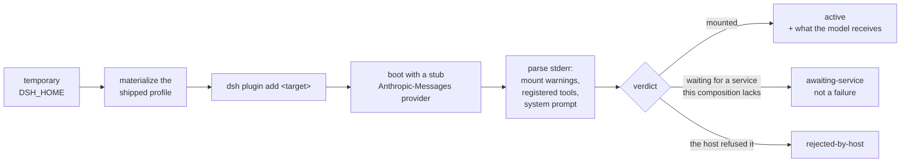

# dsh-plugin-lint

[](https://www.npmjs.com/package/@shidesheng0218/dsh-plugin-lint)
[](https://github.com/shidesheng0218/dsh-plugin-lint/actions/workflows/ci.yml)
[](LICENSE)
[](package.json)
[](package.json)

**The upgrade-day crystal ball for DeepSeek Harness plugins: lint what the code declares, then boot a real host and watch what it actually does. Evidence-backed, zero-config, zero runtime dependencies.**

[Rules](#the-rules) · [Probe](#the-probe-reading-behaviour-not-code) · [Matrix](#the-compatibility-matrix) · [Panel](#the-panel-the-matrix-where-you-live) · [Conflicts](#composition-conflicts-one-name-two-plugins) · [Federation](#federation-authors-run-the-probe-too) · [中文](#中文)


*The panel — itself a DSH plugin — running in a throwaway web profile: what this profile has installed, and how each plugin fares across DSH versions. It passes this project's own linter with zero findings.*

---

## The bugs that only surface when it's too late

A DSH plugin can be written exactly the way its author intended and still hurt someone — just later, and somewhere else. Measured on 2026-10-13 against the top published community plugins:

| The time bomb | How often | When it goes off |
| --- | --- | --- |
| `files[]` omits an artifact the manifest points at | insurance, rarely seen | **at publish** — works locally, broken in the tarball |
| Loads a `@deepseek-ai/dsh-client-*` package as a module | **62%** of the Top 100 | at the next DSH update — these change without notice |
| No `dsh.compatibility.dshReleases` declared | **87%** of the Top 100 | on upgrade day — for the user, it's a coin flip |
| A second plugin claims the same tool name | rare, but fatal | **the later plugin never activates — and the exit code is still 0** |

That last row deserves a pause. The host refuses the later registration, discards the **whole** plugin, prints a warning, and exits 0. Nothing you installed failed, except one of them is silently doing nothing.

## What this is

Four tools, four questions. None of them needs a build step, a config file, or a network connection to run.


Every finding carries a file, a line, an evidence excerpt, and the upstream document the rule encodes.

## What this is not

- **Not a security endorsement.** A clean run means no rule fired, nothing more.
- **Not a replacement for the tools beside it.** Each answers a different question:

| Tool | The question it answers | This project |
| --- | --- | --- |
| [dsh-plugin-doctor](https://github.com/zoahdev/dsh-plugin-doctor) | does the package structure and build hold up? | does not touch builds |
| [dsh-testkit](https://github.com/iiwish/dsh-testkit) | does it install, run and uninstall on a real host? | only checks artifacts on disk |
| [dsh-trust-check](https://github.com/liuwenji007/dsh-trust-check) | what can this plugin touch? | makes no security judgement |
| [dsh-my-guardian](https://github.com/baosfeng/my-dsh-plugins) | what happens after it breaks? | does not recover anything |
| **dsh-plugin-lint** | **is it written the way the reference says, will it survive publishing, and will it survive an upgrade?** | — |

## Sixty seconds

```bash
npx @shidesheng0218/dsh-plugin-lint .
```

```console
demo-plugin@1.0.0  9 checks

  E2 error  client bundle factory id matches nothing the loader can ask for
         lib/client.js:2
         factory id "other-name" is neither the package name "demo-plugin" nor a row name in the bundle patch.
         evidence: __ModuleLoader__.load({ id: "other-name" })
         why: the browser module table keys the factory by the id it asks for and the loader
              throws when a bundle registers another one, leaving the client half unreachable.
         doc: dsh plugin-development / references/ui-plugin.md

  W1 warn   couples the plugin to a Harness Client package
         lib/client.js:12
         loads 1 Harness Client package from the browser module table: @deepseek-ai/dsh-client-ui-primitives.
         why: the reference advises copying the primitive instead — these packages change without
              notice and a throwing component blanks the slot. Official first-party bundles do
              the same, so treat this as a coupling risk to watch at upgrade time, not a defect.

  1 error · 1 warn · 0 info
```

The linter reads code. To read **behaviour**, keep going:

```bash
node scripts/probe-boot.mjs dsh-mnemon --tools
#   active  (3732 ms)
#   tools 24 -> 41  +17: mnemon_remember, mnemon_recall, mnemon_forget, ...
#   system prompt 2640 -> 7153 chars
```

The probe boots a real DSH in a throwaway home with one plugin installed and records what the host did with it — no credentials needed, because the stub provider on localhost is the point.

## The rules

Levels are assigned by **how reliably a rule can decide**, not by how bad the pattern sounds. A rule that cannot decide reliably does not get to be an error.

**error** — mechanically decidable, never observed in the official packages

| Rule | What it catches |
| --- | --- |
| E1 | `session.append("type", …)` with a type outside the Harness event catalog (45 types, harvested from the official packages) |
| E2 | client bundle factory id ≠ anything the loader can ask for (the registration silently never resolves) |
| E3 | `main` / `exports["./client"]` / `dsh.bundle.patch` / `icon` points at a missing file |
| E4 | `dsh.client` declared with no resolvable `./client` export |
| E5 | `files[]` omits an artifact the manifest depends on — the "works locally, broken after publish" bug |

**warn** — documented risk patterns, evidence required

| Rule | What it catches |
| --- | --- |
| W1 | loads a `@deepseek-ai/dsh-client-*` package as a module (first-party packages exempt: they ship with the module table) |
| W2 | subscribes to `session/event` and rescans the log inside the listener instead of folding through `ctx.sessionProjections` |
| I3 | locale metadata exists but is not exported or published |

**info** — review hints and metadata completeness

| Rule | What it catches |
| --- | --- |
| I1 | no `dsh.compatibility.dshReleases` (or it omits the running DSH version, with `--dsh-version`) |
| I2 | no `icon`, or no `meta` title/description in `locale/<lang>.json` |
| W3 | a timer that looks unowned (brace depth is approximate on bundled output — demoted to a hint for exactly that reason) |

Rules the first draft had, and why they are gone: "a waterfall listener must call `next()`" (real plugins reject deliberately, and re-enter `ctx.llm.stream()` on purpose), "never listen to `system-prompt/assemble`" (the official packages do, four times), "never subscribe to `session/event`" (the reference forbids *rescanning*, not subscribing). See [docs/06](docs/06-detailed-design.md).

The reference, verbatim — this is what W1 encodes:

> Do not `require('@deepseek-ai/dsh-client-ui-primitives')` or load any other Harness Client package as a module … copy markup, CSS, and behavior from the primitive into the plugin.
> — `dsh plugin-development / references/practices.md`

**62% of the Top 100 published plugins do exactly this.** The most loaded package is ui-primitives (71 plugins). Nothing was checking.

## The probe: reading behaviour, not code



Two details make it work, and both were learned the hard way:

- **The success sentinel is a missing credential.** The throwaway home has no API key, so a plugin that mounted successfully ends in `MISSING_CREDENTIAL`. That is the signal.
- **The exit code is never the signal.** A mount failure is a warning and the process still exits 0.

See [docs/11](docs/11-m4-capability-probe.md).

## Why this exists

The ecosystem has 4,508 catalogued plugins and adds roughly a thousand a month. Upgrade breakage is a product category of its own (three tools sell the *recovery*), but nothing was checking the code against the documented practices.

| Observation (2026-10-13, Top 40 published plugins) | Result |
| --- | --- |
| plugins whose `peerDependencies` couple them to a Harness Client package | **16 / 40 (40%)** |
| plugins declaring `dsh.compatibility.dshReleases` | **5 / 40 (13%)** |
| plugins declaring an `icon` | 16 / 40 (40%) |

### Measured with this tool

| Run | Result |
| --- | --- |
| 80 official `@deepseek-ai/*` packages (zero-false-positive baseline) | **0 error · 0 warn** · 239 info |
| Top 100 published community plugins | **1 error · 86 warn** · 223 info |
| — of which couple to a Harness Client package | **62%** |
| — of which declare no DSH compatibility range | **87%** |

The error rules did not fire on any published plugin. They are insurance against rare, fatal mistakes — the daily value is the coupling inventory (W1) and declaration completeness (I1/I2), which nearly every plugin is missing something on. See [docs/07](docs/07-m1-results.md).

## Usage

```bash
npx @shidesheng0218/dsh-plugin-lint .            # lint the package in the current directory
npx @shidesheng0218/dsh-plugin-lint ./plugins/a ./plugins/b
npx @shidesheng0218/dsh-plugin-lint . --json     # machine-readable report
npx @shidesheng0218/dsh-plugin-lint . --sarif    # SARIF 2.1.0 for code scanning
npx @shidesheng0218/dsh-plugin-lint . --dsh-version 0.2.0-rc.2
npx @shidesheng0218/dsh-plugin-lint . --exit-code  # exit 1 when an error-level finding is present
```

Exit codes: `0` ok · `1` errors found with `--exit-code` · `2` the run failed.

## The compatibility matrix

The probe also runs as a grid: one cell per plugin version × DSH version × composition.

```bash
node scripts/matrix/run.mjs --targets matrix/targets-top50.json --concurrency 4
node scripts/matrix/site.mjs
```

Measured on 2026-10-13 over **228 cells** (57 plugins, two DSH versions, headless and web):

| Status | Cells | Meaning |
| --- | --- | --- |
| active | 136 | the host half mounted |
| awaiting-service | 31 | this composition does not provide a service it waits for |
| rejected-by-host | 30 | **the host itself refused the install** |
| install-failed | 3 | network (native package download) |

**17 of 57 plugins get a worse verdict on the newer DSH version and none get better**; 14 are the host refusing the install outright, and the largest system-prompt growth observed was 10,862 characters. Aggregate numbers: [docs/09](docs/09-ecosystem-measurements.md).

## Composition conflicts: one name, two plugins

A plugin that mounts alone can still collide with another. `conflicts.mjs` reads the tool names already recorded in the matrix cells, groups them by owner, and then verifies a candidate by installing the pair into **one** profile.

The sampled ecosystem had no collisions (16 plugins, 118 tool names), so two fixtures claim the same tool name on purpose. Measured result:

| Stage | Result |
| --- | --- |
| each alone | both `active`, +1 tool each |
| **installed together** | **the later one never activates** |

```text
┌────────────────────┐         ┌────────────────────┐
│  tool-alpha        │         │  tool-beta         │
│  alone: active     │         │  alone: active     │
│  +1 tool           │         │  +1 tool           │
└─────────┬──────────┘         └─────────┬──────────┘
          │   both claim "collide_probe" │
          └──────────────┬───────────────┘
                         ▼
              ┌─────────────────────┐
              │  installed together │
              │  tool-alpha: active │
              │  tool-beta:  GONE   │   ← inactive-error
              │  exit code: 0  ⚠    │   ← still zero
              └─────────────────────┘

  tool-beta: Error: tool "collide_probe" is already registered
    (for a per-agent variant, register through that agent's `agent.ctx` instead)
```

It is not "the last one wins" — the later plugin is discarded whole. And because a failed mount is only a warning with exit code 0, a user can run two clashing plugins with one of them silently doing nothing. See [docs/18](docs/18-composition-conflicts.md).

## The panel: the matrix where you live

[`panel/`](panel/) is a real DSH plugin: a settings section listing what this profile has installed and how each plugin fares across DSH versions, read from the matrix snapshot. The screenshot at the top of this file is it, captured by [`scripts/screenshot-panel.mjs`](scripts/screenshot-panel.mjs) in a throwaway web profile.

```bash
node scripts/matrix/bundle-panel-data.mjs          # snapshot the matrix into the package
dsh plugin --profile <profile> add <absolute path to panel/>
```

It mounts on both pinned DSH versions in both compositions, and it passes this project's own linter with zero findings — only `react` comes from the browser module table, no Harness Client package is imported, and colours use `--dsw-alias-*` tokens with fallbacks.

Visual verification caught two bugs a code review had not: the page said "Running DSH unknown" because `import.meta.resolve` cannot see the harness from inside a profile, and it called first-party bundles "not installed" although the dsh installation provides them. Both are fixed, and [docs/16](docs/16-m5-panel.md) records what was checked.

## Federation: authors run the probe too

Plugin authors can run the same probe from their own CI — [docs/15](docs/15-federation.md):

```yaml
- uses: shidesheng0218/dsh-plugin-lint/.github/actions/probe@v1
  with:
    target: .
    dsh-versions: 0.2.0-rc.2,0.2.1-alpha.2
```

Self-reported cells are never presented as ours: they are sampled, re-run, and either promoted to `verified` or marked `disputed` with both verdicts kept. A disagreement is never hidden — that is what makes the rest of the matrix worth trusting.

| Trust level | Source | Meaning |
| --- | --- | --- |
| `verified` ✅ | our runs, or a sampled re-run that matched | we stand behind "this is what we observed" |
| `self-reported` 🟡 | author's CI, not yet re-run | represents only what the author reported |
| `disputed` ⚠️ | re-run disagreed | **both verdicts stay in the file**, the difference is public |
| `stale` ⏳ | older than 30 days, or a newer DSH exists | the verdict may have expired |

## Methodology: every scale-up exposed a systematic misjudgement

The most valuable rows in this table are the corrections. Each round of wider sampling caught a bug in the *measuring*, not the measured — and each correction is now load-bearing:

| Round | Scale | What it exposed | The fix |
| --- | --- | --- | --- |
| smoke | 22 cells | "waiting for a service" was scored as failure | renamed `awaiting-service` + added the web composition |
| Top 50 | 200 cells | **exit codes** were trusted as install results (23 of 26 "failures" had in fact installed) | verify the **artifact**: did the profile's package.json change? |
| rule design | — | 3 of the first 12 rules would have flagged the official packages | rules re-graded by decidability; the official packages are the zero-false-positive baseline |

**Small samples cannot find systematic bias; widening the sample is itself a verification method.** No rule and no verdict criterion ships until it has run on real data. See [docs/09](docs/09-ecosystem-measurements.md).

## Data policy

This repository ships the **tool**, not the results. Any output that names a package — `reports/`, `notify/`, `matrix/cells/`, `matrix/index/`, `site/`, and the panel's matrix snapshot — is generated locally and untracked.

Two reasons, and they point the same way:

1. **Naming a package is a claim about someone's work.** Doing it well means contacting that maintainer first, and that is a decision, not a default.
2. **Verified data is only meaningful for the environment that produced it.** Whoever runs the probe gets their own answer; a snapshot from our machine is not evidence about theirs.

The aggregate numbers are published, because they describe the ecosystem rather than any one maintainer: see [docs/09](docs/09-ecosystem-measurements.md).

## Reports

```bash
node scripts/build-report.mjs --top 100              # ecosystem coupling & declaration report
node scripts/build-contact-list.mjs reports/<date>   # who to notify before publishing
node scripts/build-notification-pack.mjs             # notify/NOTIFICATIONS.md + one message per package
```

Every report names packages, so the project follows one rule (ADR D-001): **name the package, state only what was detected, cite the source, and notify the maintainer first.** See [docs/08](docs/08-author-notification.md).

## Development

```bash
npm test                 # unit tests for every rule (node:test, no dependencies)
npm run e2e:official     # zero-false-positive baseline against official packages
```

`npm run e2e:official` is the acceptance test that matters: it lints the official `@deepseek-ai/*` packages, which are the reference implementation of the documented practices. **Any error-level finding on them is a bug in a rule, not in the package.** Extract the fixtures first:

```bash
node scripts/extract-official-fixtures.mjs        # reads an installed DSH (asar)
node scripts/extract-official-fixtures.mjs --limit 80
```

## License

Apache-2.0. See [NOTICE](NOTICE) for the data derived from DeepSeek Harness (MIT).

---

## 中文

**DeepSeek Harness 插件的"升级日水晶球"：静态检查插件写法和发布产物，动态实测插件在真实宿主里的表现。每条结论都带文件、行号、证据和官方出处；零配置、零运行时依赖。**

**它回答的四个问题**：

| 工具 | 回答的问题 |
| --- | --- |
| `dsh-plugin-lint` | 代码写得符不符合官方规范、发布出去会不会缺文件 |
| `probe-boot` | 这个插件在这个 DSH 版本上能不能挂载、给了模型什么 |
| 矩阵跑批 | 哪个版本会让它坏掉 |
| `conflicts` | 几个插件装在一起会不会互相顶掉 |

**它不是什么**：不是安全背书（干净 ≠ 安全）；也不替代旁边那几个工具——doctor 管包结构、testkit 管真实宿主生命周期、trust-check 管能力披露、my-guardian 管崩了之后怎么办。

### 为什么需要它

插件写法正确，不代表它不会伤人——只是伤得更晚、在别的地方。2026-10-13 对已发布社区插件的实测：

| 定时炸弹 | 占比 | 引爆时刻 |
| --- | --- | --- |
| `files[]` 漏掉清单引用的产物 | 少见，属保险 | **发布时**——本地正常，npm 包里是坏的 |
| 把官方 Client 包当模块加载 | Top 100 的 **62%** | 下次 DSH 更新——这些包随时会变 |
| 没声明 `dsh.compatibility.dshReleases` | Top 100 的 **87%** | 升级那天——用户体验纯靠运气 |
| 两个插件抢同一个工具名 | 罕见但致命 | **后装的整个报废——而退出码仍是 0** |

最后一行值得停一下：宿主拒绝后注册的那个，**整个插件被丢弃**，打印一条 warning，退出码 0。你装的插件没有一个"失败"，只是其中一个在悄悄摸鱼。

规则分级按**"能不能可靠判定"**来定，而不是按听起来多严重：error 级必须机器可判且官方包里从不出现；warn 级是官方文档点名的风险写法，必须附证据；info 级是提示与元数据完整性。官方文档原文（W1 的出处）：

> Do not `require('@deepseek-ai/dsh-client-ui-primitives')` or load any other Harness Client package as a module … copy markup, CSS, and behavior from the primitive into the plugin.
> — `dsh plugin-development / references/practices.md`

**Top 100 里 62% 的插件恰恰就是这么写的**，而被加载最多的 ui-primitives 有 71 个插件引用。此前没有任何工具在查这件事。

### 两个只有实测才能知道的坑

- **宿主拒绝安装时只是 warning、退出码仍为 0**——所以退出码永远不是信号，stderr 才是；安装结果要校验产物（profile 的 package.json 是否变化），不能信退出码（实测 26 个"装失败"里 23 个其实装成功了）。
- **两个插件抢同一个工具名时，后注册的那个整个插件报废**，而不是覆盖——而且因为是 warning + 退出码 0，用户可以带着一个永远干活的插件和一个永远摸鱼的插件一直用下去：

```text
┌────────────────────┐         ┌────────────────────┐
│  tool-alpha        │         │  tool-beta         │
│  单独装：active     │         │  单独装：active     │
│  +1 个工具          │         │  +1 个工具          │
└─────────┬──────────┘         └─────────┬──────────┘
          │  都注册 "collide_probe"       │
          └──────────────┬───────────────┘
                         ▼
              ┌─────────────────────┐
              │  装进同一个 profile  │
              │  tool-alpha: active │
              │  tool-beta:  消失   │   ← inactive-error
              │  退出码: 0      ⚠   │   ← 仍然是 0
              └─────────────────────┘
```

### 实测数据（2026-10-13）

- **Top 40** 社区插件里，**40%** 的 peerDependencies 耦合了官方 Client 包、只有 **13%** 声明了兼容的 DSH 版本；
- **228 格**兼容矩阵（57 插件 × 2 个 DSH 版本 × 2 种组合）里，**17 个插件在新版上结论变差，没有一个变好**——其中 14 个是宿主直接拒绝安装；
- 单插件注册工具最多 **+34 个**，系统提示词增长最大 **+10,862 字符**；
- 验收基线：80 个官方 `@deepseek-ai/*` 包 **0 error · 0 warn**——官方包是文档规范的参考实现，error 级命中官方包先假定是规则的 bug。

### 方法学：每一轮扩样都暴露一个系统性误判

这是本项目最有价值的部分，也是"先扩样再对外"这个顺序的理由：

| 轮次 | 规模 | 暴露的问题 | 修正 |
| --- | --- | --- | --- |
| 冒烟 | 22 格 | 把"等待服务"当成失败（headless 组合不提供 web 侧服务，插件根本没得到挂载机会） | 改名 awaiting-service + 新增 web 组合探针 |
| Top 50 | 200 格 | 把**退出码**当成安装结果（26 个 install-failed 里 23 个其实装成功了） | 改为**校验产物**：profile 的 package.json 是否变化 |
| 规则设计 | — | 初版 12 条规则里有 3 条按字面实现会误报官方包 | 规则按"可判定性"三级分级，官方包作为零误报基线 |

**小样本发现不了系统性偏差，扩样本身就是验证手段。** 每条规则、每个状态判据都必须在真实数据上跑过才允许对外。详见 [详细设计](docs/06-detailed-design.md) 与 [生态测量](docs/09-ecosystem-measurements.md)。

### 数据政策

仓库只发工具，不发点名结果——凡是会点名具体包的数据（`reports/`、`matrix/cells/`、`notify/`、`site/`、面板的矩阵快照）都在本地生成、不进版本库，原因有两条，且指向同一个方向：

1. **点名一个包，就是对他人的工作公开下断言**——做对的做法是先通知维护者，这是一个决定，不是默认值；
2. **验证数据只对产生它的环境有意义**——谁跑探针，数据就是谁的答案；我们机器上的快照不是关于别人环境的证据。

生态聚合数字照常发布（描述的是生态，不是某个维护者），见 [生态测量](docs/09-ecosystem-measurements.md)。

### 五分钟上手

```bash
npx @shidesheng0218/dsh-plugin-lint .            # 体检当前目录的插件
npx @shidesheng0218/dsh-plugin-lint . --json     # 机器可读报告（接 CI）
node scripts/probe-boot.mjs <插件名> --tools      # 实测挂载 + 读工具清单与提示词成本
node scripts/matrix/run.mjs --targets matrix/targets-top50.json   # 重跑兼容矩阵
```

退出码：`0` 正常 · `1` 有 error 级发现（配合 `--exit-code`）· `2` 本次运行失败。

### 文档地图

[生态调研](docs/01-ecosystem-map.md) · [决策记录](docs/05-decision-log.md) · [详细设计](docs/06-detailed-design.md) · [M1 结果](docs/07-m1-results.md) · [作者通知](docs/08-author-notification.md) · [生态测量](docs/09-ecosystem-measurements.md) · [探针验证](docs/10-m4-verification.md) · [能力探针](docs/11-m4-capability-probe.md) · [联邦机制](docs/15-federation.md) · [面板](docs/16-m5-panel.md) · [发布记录](docs/17-release.md) · [构成冲突](docs/18-composition-conflicts.md)

## License / 许可证

Apache-2.0。派生自 DeepSeek Harness（MIT）的数据见 [NOTICE](NOTICE)。
