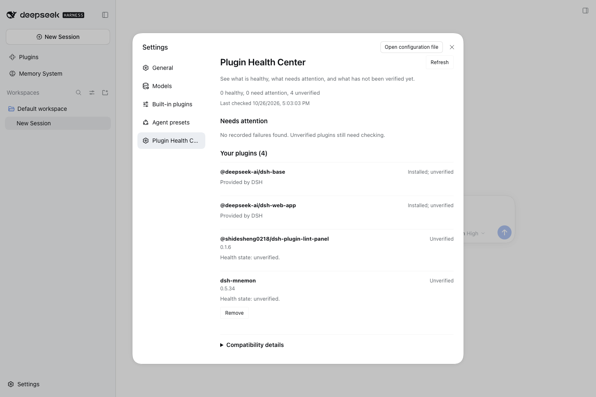
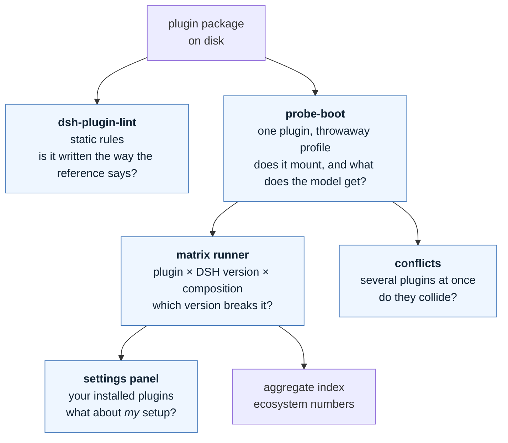
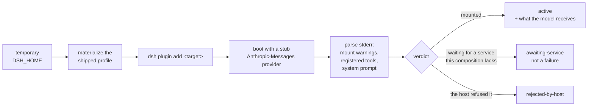

# dsh-plugin-lint

[](https://www.npmjs.com/package/@shidesheng0218/dsh-plugin-lint)
[](https://github.com/shidesheng0218/dsh-plugin-lint/actions/workflows/ci.yml)
[](LICENSE)
[](package.json)
[](package.json)

**Conformance checks and a compatibility matrix for DeepSeek Harness plugins: what the code declares, what it publishes, and what the host does with it.**

[Rules](#the-rules) · [Probe](#the-probe) · [Matrix](#the-compatibility-matrix) · [Panel](#the-panel) · [v0.3 analysis (experimental)](#v03-analysis-experimental-unpublished) · [Federation](#federation) · [中文](#中文)



*The panel, running in a throwaway web profile: what this profile has installed, and how each plugin fares across DSH versions.*

---

## Why this exists

The ecosystem catalog used for the measurements below lists 4,508 entries (snapshot 2026-10-11). Upgrade breakage is a recurring problem, and the code that plugins publish is not checked against the documented practices.

Measured on 2026-10-13 against the Top 100 published community plugins (static analysis of the published tarballs; no plugin code was executed):

| Observation | Result |
| --- | --- |
| plugins that load at least one Harness Client package | **62 / 100 (62%)** |
| plugins declaring `dsh.compatibility.dshReleases` | **13 / 100 (13%)** |
| plugins declaring no compatibility range | **87 / 100 (87%)** |
| plugins declaring an `icon` | 31 / 100 (31%) |
| plugins triggering at least one error-level rule | 1 / 100 (1%) |

A coupling to `@deepseek-ai/dsh-client-*` breaks when the host updates those packages without notice. A missing compatibility declaration means upgrade day is untested. A `files[]` gap passes local testing and only fails in the published tarball.

The raw artifacts behind these numbers (`reports/`, `matrix/cells/`) are generated locally and gitignored; they are not part of a clean clone. See [docs/09](docs/09-ecosystem-measurements.md) for the aggregate record and the [data policy](#data-policy).

## What this is

Four tools that answer four different questions about a DeepSeek Harness plugin.



The linter and the static analysis commands need no build step, no config file and no network access. The probe and the matrix runner install packages from npm, so they need network access; the upgrade planner reads a local matrix and makes no network request.

Every lint finding carries a file, a line, an evidence excerpt, and the upstream document the rule encodes.

## What this is not

- **Not a security endorsement.** A clean run means no rule fired, nothing more.
- **Not a replacement for the tools beside it.** Each answers a different question:

| Tool | The question it answers | This project |
| --- | --- | --- |
| [dsh-plugin-doctor](https://github.com/zoahdev/dsh-plugin-doctor) | does the package structure and build hold up? | does not touch builds |
| [dsh-testkit](https://github.com/iiwish/dsh-testkit) | does it install, run and uninstall on a real host? | only checks artifacts on disk |
| [dsh-trust-check](https://github.com/liuwenji007/dsh-trust-check) | what can this plugin touch? | makes no security judgement |
| [dsh-my-guardian](https://github.com/baosfeng/my-dsh-plugins) | what happens after it breaks? | does not recover anything |
| **dsh-plugin-lint** | **is it written the way the reference says, will it survive publishing, and will it survive an upgrade?** | — |

```console
$ node bin/dsh-plugin-lint.mjs .
demo-plugin@1.0.0  11 checks

  E2 error  client bundle factory id matches nothing the loader can ask for
         lib/client.js:2
         factory id "other-name" is neither the package name "demo-plugin" nor a row name in the bundle patch.
         evidence: __ModuleLoader__.load({ id: "other-name" })
         why: the browser module table keys the factory by the id it asks for and the loader
              throws when a bundle registers another one, leaving the client half unreachable.
         doc: dsh plugin-development / references/ui-plugin.md

  W1 warn   couples the plugin to a Harness Client package
         lib/client.js:12
         loads 1 Harness Client package from the browser module table: @deepseek-ai/dsh-client-ui-primitives.
         why: the reference advises copying the primitive instead — these packages change without
              notice and a throwing component blanks the slot. Official first-party bundles do
              the same, so treat this as a coupling risk to watch at upgrade time, not a defect.

  1 error · 1 warn · 0 info
```

The header count is read from the rule set (`RULES.length`); it is 11 in this checkout.

## The rules

Levels are assigned by **how reliably a rule can decide**, not by how bad the pattern sounds. A rule that cannot decide reliably does not get to be an error.

Rule IDs are stable identifiers, not severity labels: `W3` reports at info level and `I3` at warn level. The tables below are grouped by level.

**error** — mechanically decidable, never observed in the official packages

| Rule | What it catches |
| --- | --- |
| E1 | `session.append("type", …)` with a type outside the Harness event catalog (380 types harvested from the official packages; 379 observed) |
| E2 | client bundle factory id ≠ anything the loader can ask for (the registration silently never resolves) |
| E3 | `main` / `exports["./client"]` / `dsh.bundle.patch` / `icon` points at a missing file |
| E4 | `dsh.client` declared with no resolvable `./client` export |
| E5 | `files[]` omits an artifact the manifest depends on — the "works locally, broken after publish" bug |

**warn** — documented risk patterns, evidence required

| Rule | What it catches |
| --- | --- |
| W1 | loads a `@deepseek-ai/dsh-client-*` package as a module (first-party packages exempt: they ship with the module table) |
| W2 | subscribes to `session/event` and rescans the log inside the listener instead of folding through `ctx.sessionProjections` |
| I3 | locale metadata exists but is not exported or published |

**info** — review hints and metadata completeness

| Rule | What it catches |
| --- | --- |
| I1 | no `dsh.compatibility.dshReleases` (or it omits the running DSH version, with `--dsh-version`) |
| I2 | no `icon`, or no `meta` title/description in `locale/<lang>.json` |
| W3 | a timer that looks unowned (brace depth is approximate on bundled output, which is why this is a hint and not a warning) |

Rules the first draft had, and why they are gone: "a waterfall listener must call `next()`" (real plugins reject deliberately, and re-enter `ctx.llm.stream()` on purpose), "never listen to `system-prompt/assemble`" (the official packages do, four times), "never subscribe to `session/event`" (the reference forbids *rescanning*, not subscribing). See [docs/06](docs/06-detailed-design.md).

W1 encodes this passage from the reference, verbatim:

> Do not `require('@deepseek-ai/dsh-client-ui-primitives')` or load any other Harness Client package as a module … copy markup, CSS, and behavior from the primitive into the plugin.
> — `dsh plugin-development / references/practices.md`

Measured on 2026-10-13: 62 of the Top 100 published plugins load at least one of these packages. The ui-primitives package is referenced by 48 distinct plugins; 71 of the 86 W1 findings mention it (one plugin can produce more than one finding).

### Measured with this tool

| Run | Result |
| --- | --- |
| 80 official `@deepseek-ai/*` packages (zero-false-positive baseline) | **0 error · 0 warn** · 241 info |
| Top 100 published community plugins | **1 error · 86 warn** · 240 info |
| — of which couple to a Harness Client package | **62%** |
| — of which declare no DSH compatibility range | **87%** |

The official-package run predates the Top 100 run (both 2026-10-13); the two info totals are no longer equal (241 = 80 I1 + 160 I2 + 1 W3 on the official set; 240 = 87 I1 + 136 I2 + 17 W3 on the Top 100). The error rules fired on 1 of the 100 published plugins (E1: an append type outside the catalog). The daily value is the coupling inventory (W1) and declaration completeness (I1/I2), which nearly every plugin is missing something on. See [docs/07](docs/07-m1-results.md) and [docs/09](docs/09-ecosystem-measurements.md).

## The probe

Static analysis reads code. The probe reads **behaviour**: it boots a real DSH in a throwaway home with one plugin installed and records what the host did with it.



Two details make it work, and both were learned the hard way:

- **The success sentinel is a missing credential.** The throwaway home has no API key, so a plugin that mounted successfully ends in `MISSING_CREDENTIAL`. That is the signal.
- **The exit code is never the signal.** A mount failure is a warning and the process still exits 0.

```bash
node scripts/probe-boot.mjs dsh-mnemon --tools --dsh 0.2.0-rc.2
#   active  (3732 ms)
#   tools 24 -> 41  +17: mnemon_remember, mnemon_recall, mnemon_forget, ...
#   system prompt 2640 -> 7153 chars
```

That is example output from the 2026-10-13 run. The probe runs the target in a hardened Docker container (read-only root, no capabilities, no-new-privileges, non-root, network only during install) and refuses to run when Docker is unavailable. `--unsafe-host` is the explicit escape hatch: it runs the desktop DSH and the plugin in the current user's environment without isolation, and its results stay self-reported. The Docker backend needs an explicit `--dsh <version>`; the desktop DSH can only be probed with `--unsafe-host`. Run the probe only on plugins you are willing to execute.

See [docs/11](docs/11-m4-capability-probe.md).

## Usage

The npm release is **0.1.0** (published 2026-10-14). This checkout is the **0.4.0 release candidate, unpublished**; the analysis commands described below exist only in the checkout.

```bash
npx @shidesheng0218/dsh-plugin-lint .            # lint the package in the current directory
npx @shidesheng0218/dsh-plugin-lint ./plugins/a ./plugins/b
npx @shidesheng0218/dsh-plugin-lint . --json     # machine-readable report
npx @shidesheng0218/dsh-plugin-lint . --sarif    # SARIF 2.1.0 for code scanning
npx @shidesheng0218/dsh-plugin-lint . --dsh-version 0.2.0-rc.2
npx @shidesheng0218/dsh-plugin-lint . --exit-code  # exit 1 when an error-level finding is present
```

Exit codes: `0` ok · `1` errors found with `--exit-code` · `2` the run failed.

To run the checkout instead of the npm release, use `node bin/dsh-plugin-lint.mjs <dir>`. Commands in this README that start with `node scripts/` also run from a **checkout** — the matrix runner, the probe, the upgrade preview, and the report builders read files the npm package does not ship.

## v0.3 analysis (experimental, unpublished)

The workspace is at 0.4.0 (release candidate); the latest npm release is 0.1.0. The four capabilities below ship in the checkout only and are **experimental**: they are static heuristics over files on disk. None of them executes a plugin, measures runtime cost, or issues a security verdict. A clean run means no pattern matched.

| Command | The question it answers |
| --- | --- |
| `dsh-plugin-analyze conflicts <dir...>` | do two or more plugins claim the same slot, tool name, route or config key? |
| `dsh-plugin-analyze performance <dir>` | how much does the package ship, and which static patterns look expensive? |
| `dsh-plugin-analyze security <dir>` | which patterns would a reviewer want to look at first? |
| `dsh-plugin-analyze full <dir>` | lint + performance + security for one package |
| `dsh-plugin-upgrade-plan ...` | given a profile and a target DSH version, which plugins need action? |

All four `analyze` subcommands accept `--json` (stdout is pure JSON; diagnostics go to stderr) and `--exit-code`. `--help` exits 0; an unknown option exits 2; a missing package directory exits 2.

With `--exit-code`: `conflicts` exits 1 when any conflict is found, `security` exits 1 when a warning-level finding is present (info-level inventory entries do not gate), `full` exits 1 when lint reports an error or security reports a warning, and `performance` always exits 0 (a score is not a gate). Without the flag every successful run exits 0.

### Composition conflicts

```bash
node bin/dsh-plugin-analyze.mjs conflicts ./plugin-a ./plugin-b ./plugin-c
node bin/dsh-plugin-analyze.mjs conflicts ./plugin-a ./plugin-b --json
```

The static scan compares literals at registration sites: UI slot names (`ctx.slots.inject` / `ctx.slots.register`), tool names (`ctx.tools.register(defineTool(...))` and declarative arrays), route paths (`connection.fetch.register`, older `ctx.router.*`), config keys, and waterfall listeners. A name claimed by two plugins is reported with the file, line and a resolution hint; two declarations by the same plugin are not reported as a conflict. Dynamic names are not resolved. The runtime authority is `scripts/matrix/conflicts.mjs`, which installs the plugins together and reads what the host registered — the static scan is a pre-flight hint, and a miss is not proof that two plugins compose.

### Performance analysis

```bash
node bin/dsh-plugin-analyze.mjs performance ./my-plugin
```

Static counts, not measurements: shipped and JavaScript bytes, largest files, lines/functions/nesting depth (long functions are >100 lines), DOM access patterns, literal network call sites, and heavy dependency patterns. Comments are excluded because the analysis reads the masked source. The 0–100 score is a heuristic index assembled from fixed penalty thresholds; it is useful for comparing two packages or tracking a package over time, not as a runtime claim. A package with no JavaScript to analyse scores 0 with rating `insufficient-data` — the absence of evidence is not a clean bill.

### Security deep analysis

```bash
node bin/dsh-plugin-analyze.mjs security ./my-plugin
```

Ten pattern rules (S1–S10) look for session data sent to external domains, credentials written to browser storage, `eval`/`Function`, non-static `innerHTML` in the client entry, literal external domains, shell commands built by interpolation, absolute-path file access, crypto use, `process.env` access, and insecure HTTP. Every rule reports at warn or info level: these patterns are not mechanically decidable, so none is an error. Rules read the masked source, so a URL or `eval` inside a comment is not a finding. S5 is an inventory of literal external domains — the report does not compare them against a declared capability, because the DSH manifest has no such field. `riskLevel` summarises the warning count (minimal · low · medium · high, no "critical") and is not a verdict; read the findings, not the label.

### Upgrade plan

```bash
node bin/dsh-plugin-upgrade-plan.mjs --from 0.2.0-rc.2 --to 0.2.1-alpha.2 --installed ~/.dsh/profiles/default
node bin/dsh-plugin-upgrade-plan.mjs --from 0.2.0-rc.2 --to 0.2.1-alpha.2 --installed <profile> --matrix matrix/cells --json
node bin/dsh-plugin-upgrade-plan.mjs --check-compatibility ./my-plugin --target 0.2.1-alpha.2
```

It reads the profile's installed bundles, joins them against the local matrix in `matrix/cells` (override with `--matrix <dir>`), and reports what changes on the target version. It makes no network request and does not query npm for newer versions: a recommended version is one the matrix observed active on the target DSH version. `--json` emits pure JSON in both modes.

Exit codes for the analysis mode: `0` no action needed · `1` at least one plugin needs an update or has no compatible version · `2` the run failed, including when no matrix data is available. `--check-compatibility`: `0` compatible · `1` incompatible · `2` unknown or no data.

The matrix is not shipped in the npm package and `matrix/cells/` is gitignored, so this command only works where a matrix snapshot exists. Its coverage is the 50 plugins in that snapshot, not the whole ecosystem.

### Programmatic API

The analysis functions live behind the `./experimental` subpath; the package entry point keeps only the ten stable core exports. In the unpublished checkout:

```javascript
import { loadPackage } from './src/index.js';
import {
  detectConflicts,
  analyzePerformance,
  analyzeSecurityDeep
} from './src/experimental/index.js';

const packages = ['./plugin-a', './plugin-b'].map((dir) => {
  const pkg = loadPackage(dir);
  return { name: pkg.manifest.name, manifest: pkg.manifest, jsFiles: pkg.jsFiles };
});

const conflicts = detectConflicts(packages);        // { slots, toolNames, routes, configKeys, eventListeners, summary, experimental, limits }
const perf = analyzePerformance(loadPackage('./plugin-a'));   // { score, rating, recommendations, experimental, limits, … }
const security = analyzeSecurityDeep(loadPackage('./plugin-a')); // { findings, summary, riskLevel, experimental, limits, … }
```

The published 0.1.0 package predates these exports. See [docs/19](docs/19-analysis-tools.md) for field-level documentation and [docs/21](docs/21-release-0.4.0.md) for the 0.4.0 release notes (draft).

## The compatibility matrix

The probe also runs as a grid: one cell per plugin × DSH version × composition.

```bash
node scripts/matrix/run.mjs --targets matrix/targets-top50.json --concurrency 4
node scripts/matrix/site.mjs
```

The current tracked snapshot was collected on **2026-10-16** (`generatedAt 2026-10-16T02:45:50Z`): **50 plugins × 2 DSH versions × 2 compositions = 200 cells**. The counts are in [`panel/data/aggregate.json`](panel/data/aggregate.json):

| Status | 0.2.0-rc.2 | 0.2.1-alpha.2 |
| --- | --- | --- |
| active | 80 | 72 |
| awaiting-service | 16 | 20 |
| rejected-by-host | 2 | 8 |
| install-failed | 2 | 0 |

Each version column sums to 100 cells (50 plugins × headless/web). The snapshot covers only the two pinned DSH versions; newer releases are not tested.

Three data-quality caveats apply to the matrix and to anything derived from it:

- **Recorded version ≠ loaded version.** A cell records `plugin.version` from the registry at collection time, but the probe installs by bare package name. In **23 of the 200 cells** the recorded version differs from the version the cell notes was actually loaded (e.g. `dsh-context` records 0.72.0 while 0.71.0 was installed). The `reproduce` command in a cell does not pin a version, so rerunning it today can test a different release.
- **The per-plugin data is not in the repository.** `matrix/cells/` and `matrix/index/` are gitignored. A clean clone contains the target list and the aggregate counts, not the cells; rebuilding them needs network access, npm and the probe.
- **Older totals are not cited.** Earlier drafts reported a larger plugin run and a plugin-level count of verdicts that got worse. That run cannot be reconstructed from this repository, so it is not cited here; [docs/09](docs/09-ecosystem-measurements.md) records why.

### Upgrade preview

The matrix answers "which version breaks this plugin"; the preview answers the question a user actually has: **should this profile upgrade?** It reads the profile's installed bundles, joins them against the matrix, and reports what changes on the target version:

```bash
node scripts/upgrade-preview.mjs ~/.dsh/profiles/default
```

```text
Upgrade preview: 0.2.0-rc.2 -> 0.2.1-alpha.2
Profile ~/.dsh/profiles/default · 8 installed (6 community, 2 first-party)

  2 worse · 0 better · 3 unchanged · 1 not covered by the matrix

  ✗  @michengai/dsh-archive-manager
      0.2.0-rc.2: active   ->   0.2.1-alpha.2: rejected-by-host
```

The output above is an illustrative sample. A plugin the matrix does not cover is reported as unknown, not as a verdict. First-party bundles are counted but not previewed — the matrix says nothing about them.

## Composition conflicts

A plugin that mounts alone can still collide with another. `conflicts.mjs` scans two dimensions: the tool names recorded in the matrix cells (what the host registered), and the slot names each plugin's client bundle declares (what the code claims). A name claimed by two plugins in either dimension is a candidate, verified by installing the pair into **one** profile.

Measured on 2026-10-13 over the sampled ecosystem (16 plugins):

| Dimension | Collisions found |
| --- | --- |
| tool names (118 distinct) | **0** |
| slot names (37 distinct) | **10** — `settings.section` alone is claimed by three plugins |

The tool-name result is a clean bill; the slot result is not. Two fixtures claim the same tool name on purpose to show what a collision looks like:

| Stage | Result |
| --- | --- |
| each alone | both `active`, +1 tool each |
| **installed together** | **the later one never activates** |

```text
tool-beta: Error: tool "collide_probe" is already registered
  (for a per-agent variant, register through that agent's `agent.ctx` instead)
```

It is not "the last one wins" — the later plugin is discarded whole. And because a failed mount is only a warning with exit code 0, a user can run two clashing plugins with one of them silently doing nothing. This measurement is historical: it depends on matrix cells that are gitignored, and the installed-pair verification is a manual step, not part of the CLI. See [docs/18](docs/18-composition-conflicts.md).

## The panel

[`panel/`](panel/) is a real DSH plugin: a settings section — titled **Plugin Health Center** — listing what this profile has installed, how each plugin fares across DSH versions, and, below the table, aggregate ecosystem counts per version (never a package name). The screenshot at the top of this file was captured by [`scripts/screenshot-panel.mjs`](scripts/screenshot-panel.mjs) in a throwaway web profile.

The panel reads two data files: the full matrix snapshot when one exists locally (`data/matrix-index.json`, overridable with `DSH_PLUGIN_LINT_INDEX`), and the aggregate that ships in the npm package (`data/aggregate.json`, counts only). **An npm-installed panel therefore shows the ecosystem counts and marks installed plugins as uncovered; per-plugin rows need a local matrix snapshot.** The npm release is panel 0.1.5; the 0.2.0 in this checkout is a release candidate, unpublished. The published 0.1.5 predates the server-side action guards in this checkout (it has no content-type, confirmation, protected-package, or installed-only check and hardcodes `--profile desktop`), so do not install it into a profile that runs untrusted plugins until a fixed release ships.

With no per-plugin data, the page still shows the matrix overview: 50 plugins across 2 DSH versions, with 80 of 100 cells active on 0.2.0-rc.2 and 72 of 100 on 0.2.1-alpha.2.

```bash
node scripts/matrix/bundle-panel-data.mjs          # snapshot the local matrix into the package
dsh plugin --profile <profile> add <path to panel/> # from a checkout
```

It mounts on both pinned DSH versions in both compositions, and it passes this project's own linter with zero findings — only `react` comes from the browser module table, no Harness Client package is imported, and colours use `--dsw-alias-*` tokens with fallbacks.

Visual verification caught two bugs a code review had not: the page said "Running DSH unknown" because `import.meta.resolve` cannot see the harness from inside a profile, and it called first-party bundles "not installed" although the dsh installation provides them. Both are fixed, and [docs/16](docs/16-m5-panel.md) records what was checked.

## Federation

Plugin authors can run the same probe from their own CI — [docs/15](docs/15-federation.md). The composite action in `.github/actions/probe/` is **not usable yet** (its `github.action_path` points at the action directory, which does not contain the scripts it calls), so today the working path is a checkout plus:

```bash
node scripts/probe-boot.mjs <plugin-dir> --tools --dsh 0.2.0-rc.2 --mode both
```

Self-reported cells are never presented as ours: they are sampled, re-run, and either promoted to `verified` or marked `disputed` with both verdicts kept. A disagreement is never hidden — that is the property the rest of the matrix depends on.

| Trust level | Source | Meaning |
| --- | --- | --- |
| `verified` ✅ | our runs, or a sampled re-run that matched | we stand behind "this is what we observed" |
| `self-reported` 🟡 | author's CI, not yet re-run | represents only what the author reported |
| `disputed` ⚠️ | re-run disagreed | both verdicts stay in the file; the difference is public |
| `stale` ⏳ | older than 30 days, or a newer DSH exists | the verdict may have expired |

The self-reported path is not complete: the cells and the verification report it depends on are gitignored, so a self-reported cell has no tracked route into the matrix yet. Treat the mechanism as designed-but-not-operational.

## Methodology

Every round of wider sampling exposed a systematic misjudgement in the measuring, not the measured. Each correction is now load-bearing. The runs below are historical; their cells are gitignored and cannot be reconstructed from this repository:

| Round | Scale | What it exposed | The fix |
| --- | --- | --- | --- |
| smoke | 22 cells | "waiting for a service" was scored as failure | renamed `awaiting-service` + added the web composition |
| Top 50 | 200 cells | exit codes were trusted as install results (23 of 26 "failures" had in fact installed) | verify the artifact: did the profile's package.json change? |
| rule design | — | 3 of the first 12 rules would have flagged the official packages | rules re-graded by decidability; the official packages are the zero-false-positive baseline |

A small sample cannot find systematic bias, so widening the sample is itself a verification step. No rule and no verdict criterion ships until it has run on real data. See [docs/09](docs/09-ecosystem-measurements.md).

## Data policy

This repository ships the **tool**, not the results. Any output that names a package — `reports/`, `notify/`, `matrix/cells/`, `matrix/index/`, `site/`, and the panel's per-plugin matrix snapshot — is generated locally and untracked.

Two reasons, and they point the same way:

1. **Naming a package is a claim about someone's work.** Doing it well means contacting that maintainer first, and that is a decision, not a default.
2. **Verified data is only meaningful for the environment that produced it.** Whoever runs the probe gets their own answer; a snapshot from our machine is not evidence about theirs.

The aggregate counts (`panel/data/aggregate.json`) are tracked, because they describe the ecosystem rather than any one maintainer. See [docs/09](docs/09-ecosystem-measurements.md).

`matrix/public/` — the runtime source the panel tries to sync — is also gitignored. Publishing it is a deliberate, manual decision (`matrix refresh` with `publish_named_data=true`), not a side effect of the weekly schedule; until that decision is made, the panel falls back to the bundled aggregate.

## Reports

```bash
node scripts/build-report.mjs --top 100              # ecosystem coupling & declaration report
node scripts/build-contact-list.mjs reports/<date>   # who to notify before publishing
node scripts/build-notification-pack.mjs             # notify/NOTIFICATIONS.md + one message per package
```

Every report names packages, so the project follows one rule (ADR D-001): **name the package, state only what was detected, cite the source, and notify the maintainer first.** See [docs/08](docs/08-author-notification.md).

## Development

```bash
npm test                 # node --test test/*.test.js: 366 cases across 41 files
npm run test:coverage    # lines >=85%, branches >=80%, functions >=80%
npm run e2e:official     # zero-false-positive baseline against official packages (needs npm access)
npm run package:smoke    # pack both tarballs, install them, run every bin and entry point
```

At this revision the suite has **366 node:test cases across 41 files**, and coverage is gated at lines ≥85%, branches ≥80%, functions ≥80%. `npm test` passes from a plain shell and from inside a DSH shell — the panel tests isolate ambient `DSH_*` variables, and the CLI tests build fixtures in temporary directories. The count is measured, not aspirational; re-run the command if you need the current number.

`npm run e2e:official` is the acceptance test that matters: it lints the official `@deepseek-ai/*` packages, which are the reference implementation of the documented practices. **Any error-level finding on them is a bug in a rule, not in the package.** The CI job fetches the packages from npm first:

```bash
node scripts/fetch-official-from-npm.mjs --limit 80
node scripts/e2e-official.mjs
```

## License

Apache-2.0. See [NOTICE](NOTICE) for the data derived from DeepSeek Harness (MIT).

---

## 中文

**给 DeepSeek Harness 插件做合规体检与兼容性实测的工具链：只陈述检测到的事实，每条结论都带文件、行号、证据和官方出处。**

四个工具，各回答一个问题：

| 工具 | 回答的问题 |
| --- | --- |
| `dsh-plugin-lint` | 代码写得符不符合官方规范、发布出去会不会缺文件 |
| `probe-boot` | 这个插件在这个 DSH 版本上能不能挂载、给了模型什么 |
| 矩阵跑批 | 哪个版本会让它坏掉 |
| `conflicts` | 几个插件装在一起会不会互相顶掉 |

它不是什么：不是安全背书（干净的运行只代表没有规则命中）；也不替代旁边几个工具——doctor 管包结构、testkit 管真实宿主生命周期、trust-check 管能力披露、my-guardian 管崩了之后怎么办。

静态检查与静态分析命令不需要构建、不需要配置文件、不需要网络；探针与矩阵跑批会从 npm 安装包，因此需要网络；升级规划只读本地矩阵，不发起网络请求。

### 为什么需要它

用于测量的生态目录快照收录 4,508 个条目（2026-10-11）。2026-10-13 对 Top 100 已发布社区插件做静态检查（分析已发布 tarball，不执行插件代码）：

| 观测 | 结果 |
| --- | --- |
| 加载了官方 Harness Client 包 | **62 / 100（62%）** |
| 声明了 `dsh.compatibility.dshReleases` | **13 / 100（13%）** |
| 没有声明任何 DSH 兼容范围 | **87 / 100（87%）** |
| 声明了展示图标 | 31 / 100（31%） |
| 触发至少一条 error 级规则 | 1 / 100（1%） |

耦合了 `@deepseek-ai/dsh-client-*` 的插件，在宿主无通知更新这些包时会坏；没声明兼容范围的插件，升级那天就是未测试状态；`files[]` 漏掉产物的问题本地测试发现不了，发布后才出现。

用本工具实测（2026-10-13）：

| 跑批 | 结果 |
| --- | --- |
| 80 个官方 `@deepseek-ai/*` 包（零误报基线） | **0 error · 0 warn** · 241 info |
| Top 100 已发布社区插件 | **1 error · 86 warn** · 240 info |
| — 其中耦合官方 Client 包 | **62%** |
| — 其中没有声明兼容范围 | **87%** |

这些数字背后的原始产物（`reports/`、`matrix/cells/`）在本地生成、被 gitignore，干净 clone 里没有。聚合记录见 [生态测量](docs/09-ecosystem-measurements.md)，数据政策见下文。

### 规则分级

按"能不能可靠判定"分级，而不是按听起来多严重：error 级必须机器可判、且在官方包里从不出现；warn 级是官方文档点名的风险写法，必须附证据；info 级是提示与元数据完整性。判不准的规则不配对插件下结论——判不准就降级，或者删掉。规则编号是稳定标识，不是严重度缩写：`W3` 实际报 info，`I3` 实际报 warn。初版 12 条规则里有 3 条按字面实现会误报官方包，已按这个原则处理，详见 [详细设计](docs/06-detailed-design.md)。

验收基线是 80 个官方 `@deepseek-ai/*` 包 **0 error · 0 warn**（241 条 info）：官方包是文档规范的参考实现，error 级规则命中官方包，先假定是规则的 bug。

E1 的事件白名单是 380 个官方 session 事件类型（采集自官方包，其中 379 个被实际观测到）。

W1 规则对应的官方文档原文：

> Do not `require('@deepseek-ai/dsh-client-ui-primitives')` or load any other Harness Client package as a module … copy markup, CSS, and behavior from the primitive into the plugin.
> — `dsh plugin-development / references/practices.md`

Top 100 里 62 个插件加载了至少一个官方 Client 包；ui-primitives 被 48 个插件引用（71 是提及它的 W1 finding 条数）。

### 探针

静态分析读代码，探针读**行为**：在一次性的 DSH_HOME 里物化官方 profile，装入一个插件，用本地桩 provider 接住宿真实发出的请求，从请求体里读出注册的工具清单和系统提示词长度。不需要 API key。

两个只有实测才能发现的坑：

- **退出码永远不是信号。** 挂载失败只是 warning，进程退出码仍为 0——所以探针解析 stderr。同理，安装结果也不能信退出码：历史跑批里 26 个"安装失败"有 23 个其实装成功了，判据改为校验产物（profile 的 package.json 是否变化）。
- **成功的哨兵是一个缺失的凭据。** 一次性环境里没有 API key，所以挂载成功的插件会以 `MISSING_CREDENTIAL` 结束。这就是信号。

探针默认在加固的 Docker 容器里运行目标插件（只读根文件系统、无 capability、非 root、仅在安装阶段联网），Docker 不可用时拒绝执行，而不是静默退回本机。`--unsafe-host` 是显式逃生口：它用桌面版 DSH 在当前用户环境里无隔离运行，结果只能算 self-reported。Docker 后端必须显式给 `--dsh <版本>`；桌面 DSH 只能用 `--unsafe-host`。只对愿意执行的插件运行探针。

### 兼容性矩阵

探针按网格跑：一格 = 一个插件 × 一个 DSH 版本 × 一种组合。当前进版本库的快照采集于 **2026-10-16**：**50 个插件 × 2 个 DSH 版本 × 2 种组合 = 200 格**，计数在 [`panel/data/aggregate.json`](panel/data/aggregate.json)：

| 状态 | 0.2.0-rc.2 | 0.2.1-alpha.2 |
| --- | --- | --- |
| active | 80 | 72 |
| awaiting-service | 16 | 20 |
| rejected-by-host | 2 | 8 |
| install-failed | 2 | 0 |

每个版本列合计 100 格（50 个插件 × headless/web）。快照只覆盖这两个固定 DSH 版本，更新的版本没有测过。

矩阵及由其派生的结论有三条数据质量限制：

- **记录版本 ≠ 实际加载版本。** cell 里的 `plugin.version` 是采集时从 registry 抓到的版本，而探针安装时用的是裸包名。**200 格里 23 格**记录的版本与 cell 自己记录的"实际装入版本"不一致（例如 `dsh-context` 记录 0.72.0、实际装的是 0.71.0）。cell 里的 `reproduce` 命令不带版本，今天重跑可能测到另一个发布版本。
- **逐插件数据不在仓库里。** `matrix/cells/` 与 `matrix/index/` 被 gitignore；干净 clone 只有目标清单和聚合计数，重建需要网络、npm 与探针。
- **旧跑批数字不引用。** 早期草稿引用的更大跑批与"变差插件数"无法从本仓库重建，本 README 不引用；原因见 [生态测量](docs/09-ecosystem-measurements.md)。

### 升级预览

矩阵回答"哪个版本会坏"，升级预览回答用户真正的问题：**这个 profile 该不该升**。读当前 profile 装了什么，与矩阵对照，报告目标版本上每个插件的变化：

```bash
node scripts/upgrade-preview.mjs ~/.dsh/profiles/default
```

输出为示例。矩阵没覆盖的插件报 "not covered / no data"，不是裁决；官方 bundle 计数但不预览——矩阵对它们无话可说。

### 构成冲突

一个插件单独能挂载，不代表它和别的插件能共存。`conflicts.mjs` 扫两个维度：矩阵格子里记录的工具名（宿主注册了什么），和每个插件 client bundle 里声明的 slot 名（代码声称要挂到哪）。任一维度撞名即为候选，再装进**同一个** profile 验证。

实测（2026-10-13，16 个插件）：工具名 **0** 撞名（118 个不同名字），**slot 名 10 个撞名**——`settings.section` 一个位置就有 3 个插件认领。工具名干净，slot 不然。

两个夹具插件故意撞名演示后果：各自单独装都正常（各 +1 个工具），**装在一起后，后注册的那个整个插件没有挂载**：

```text
tool-beta: Error: tool "collide_probe" is already registered
```

不是"后装的覆盖先装的"，是后装的整个被丢弃。又因为挂载失败只是 warning、退出码 0，用户可以在一个插件悄悄不干活的状态下一直用下去。这组测量依赖被 gitignore 的矩阵 cell，且"装进同一 profile 验证"是手工步骤，不属于 v0.3 CLI。详见 [构成冲突](docs/18-composition-conflicts.md)。

### 面板

[`panel/`](panel/) 是一个真实的 DSH 插件：设置页里一个 **Plugin Health Center** 区块，列出当前 profile 装了哪些插件、每个插件在各 DSH 版本上的兼容性结论，下方是各版本 active / awaiting-service / rejected-by-host / install-failed 的聚合计数（只有数字，没有包名）。本文顶部的截图由 [`scripts/screenshot-panel.mjs`](scripts/screenshot-panel.mjs) 在一次性 web profile 里截取。

面板读两个数据文件：本地存在全量矩阵快照时读 `data/matrix-index.json`（可用 `DSH_PLUGIN_LINT_INDEX` 覆盖），否则读 npm 包里随附的 `data/aggregate.json`（只有计数）。**因此从 npm 安装的面板只显示聚合数据，逐插件矩阵列需要本地快照。** npm 上的面板版本是 0.1.5；本工作区的 0.2.0 是未发布的 release candidate。已发布的 0.1.5 早于本仓库的服务端动作校验（没有 content-type、确认、受保护包或已安装校验，且硬编码 `--profile desktop`），在运行不受信插件的 profile 里先不要安装，直到修复版发布。

没有逐插件数据时，页面仍展示矩阵全景：50 个插件 × 2 个版本，0.2.0-rc.2 上 100 格里 80 格 active，0.2.1-alpha.2 上 72 格 active。

它用这个项目的 linter 检查自己是 0 发现（11 checks）：只有 react 来自浏览器模块表，没有引入任何 Harness Client 包，颜色只用 `--dsw-alias-*` 令牌（带回退）。视觉验证抓到两个代码评审没发现的 bug，见 [docs/16](docs/16-m5-panel.md)。

### v0.3 分析能力（experimental，未发布）

工作区版本 0.4.0（release candidate）；npm 最新发布是 0.1.0。下面四个能力（`full` 是组合命令）只在源码 checkout 里存在，且都是 **experimental**：对磁盘文件做静态启发式检查，不执行插件、不做运行时测量、不做安全裁决。干净运行只代表没有模式命中。

| 命令 | 回答的问题 |
| --- | --- |
| `dsh-plugin-analyze conflicts <dir...>` | 两个以上插件是否抢同一个 slot / 工具名 / 路由 / 配置键 |
| `dsh-plugin-analyze performance <dir>` | 包体积与静态"看起来重"的模式有多少 |
| `dsh-plugin-analyze security <dir>` | 哪些模式值得人工先看一眼 |
| `dsh-plugin-analyze full <dir>` | 单包的 lint + performance + security |
| `dsh-plugin-upgrade-plan ...` | 给定 profile 与目标 DSH 版本，哪些插件需要处理 |

四个 `analyze` 子命令都支持 `--json`（stdout 纯 JSON，诊断信息写 stderr）与 `--exit-code`；`--help` 退出 0，未知选项退出 2，目录缺 package.json 退出 2。带 `--exit-code` 时：`conflicts` 有冲突退 1，`security` 有 warn 级 finding 退 1（info 级清单不触发门禁），`full` 在 lint 有 error 或 security 有 warn 级 finding 时退 1，`performance` 始终退 0（评分不是门禁）。

安全分析 S1–S10 全部是 warn/info，没有 error：这些模式不是机器可判的。性能评分 0–100 是按固定阈值扣分得到的启发式指标，静态计数而非运行时测量；没有可分析的 JS 时 score 为 0、rating 为 insufficient-data。冲突检测是静态模式匹配，只认得解析器覆盖的注册写法，漏报可能出现；运行时权威是装进同一 profile 的 `scripts/matrix/conflicts.mjs`。

`dsh-plugin-upgrade-plan` 读 profile 已装 bundle 与本地矩阵（默认 `matrix/cells`，可用 `--matrix <dir>` 指定），不访问网络、不查 npm 新版本；分析模式退出码 0 无需动作 / 1 需更新或无兼容版本 / 2 运行失败（含无矩阵数据）；`--check-compatibility` 0 兼容 / 1 不兼容 / 2 未知或无数据。矩阵不在 npm 包内且 `matrix/cells/` 被 gitignore，覆盖范围是快照里的 50 个插件。

API 见 [docs/19](docs/19-analysis-tools.md)，未发布版本的 release notes 见 [docs/21](docs/21-release-0.4.0.md)。

### 联邦机制

插件作者可以在自己的 CI 里跑同一个探针（见 [联邦机制](docs/15-federation.md)）。注意 `.github/actions/probe/` 里的 composite action 目前不可用（`github.action_path` 指向 action 目录，目录里没有它要调用的脚本），当前可行路径是 checkout 本仓库后直接跑 `node scripts/probe-boot.mjs`。自报的格子不会被当成我们的结论：会被抽样复跑，一致就升级为 verified，不一致就标 disputed 且**两个结论都保留**。分歧不会被掩盖——这是矩阵其余部分值得信任的前提。

| 信任级别 | 来源 | 含义 |
| --- | --- | --- |
| verified ✅ | 本项目跑批，或抽检复跑一致 | 我们背书"我们跑出来是这样" |
| self-reported 🟡 | 作者 CI 上传，未经复验 | 只代表作者所述 |
| disputed ⚠️ | 复跑结果与自报不一致 | 两个结论都留在文件里，差异公开 |
| stale ⏳ | 超过 30 天，或 DSH 已发新版 | 结论可能过期 |

自报路径目前不完整：它依赖的 cell 与复验报告都被 gitignore，自报结论还没有进版本库的通道。这一机制算"设计存在、尚未跑通"。

### 数据政策

仓库只发工具，不发点名结果——凡是会点名具体包的数据（`reports/`、`matrix/cells/`、`notify/`、`site/`、面板的逐插件矩阵快照）都在本地生成、不进版本库。原因有两条：

1. 点名一个包是对他人工作的公开断言——做对的做法是先通知维护者，这是一个决定，不是默认值；
2. 验证数据只对产生它的环境有意义——谁跑探针，数据就是谁的答案；我们机器上的快照不是关于别人环境的证据。

聚合计数（`panel/data/aggregate.json`）进版本库，因为它描述的是生态而不是某个维护者，见 [生态测量](docs/09-ecosystem-measurements.md)。

面板运行时会尝试同步的 `matrix/public/` 同样被 gitignore。发布它是显式的人工决定（`matrix refresh` 勾选 `publish_named_data=true`），不是每周调度的默认副作用；在这个决定做出之前，面板回退到随包附带的聚合计数。

### 用法

npm 发布版本是 **0.1.0**（2026-10-14 发布）。本工作区是 **0.4.0 release candidate，未发布**；下文的分析命令只在源码 checkout 里存在。

```bash
npx @shidesheng0218/dsh-plugin-lint .            # 体检当前目录的插件（npm 0.1.0）
npx @shidesheng0218/dsh-plugin-lint . --json     # 机器可读报告
npx @shidesheng0218/dsh-plugin-lint . --exit-code  # 有 error 级发现时退出码为 1
node scripts/probe-boot.mjs <插件名> --tools --dsh 0.2.0-rc.2  # Docker 探针（或加 --unsafe-host 用桌面版）
node scripts/matrix/run.mjs --targets matrix/targets-top50.json   # 重跑兼容矩阵
node bin/dsh-plugin-analyze.mjs full panel --json # v0.3 分析（源码 checkout）
```

退出码：`0` 正常 · `1` 有 error 级发现（配合 `--exit-code`）· `2` 本次运行失败。

本 README 里以 `node scripts/` 开头的命令需要**克隆本仓库**运行——矩阵跑批、升级预览、探针与报告生成都依赖 npm 包里不包含的文件。

### 测试

```bash
npm test   # node --test test/*.test.js：366 个用例，41 个文件
npm run test:coverage   # 行 ≥85%、分支 ≥80%、函数 ≥80%
npm run package:smoke   # 打包两个 tarball、安装、运行全部 bin 与入口
```

当前 revision 的实测：366 个 `node:test` 用例、41 个测试文件，覆盖率门禁为行 ≥85%、分支 ≥80%、函数 ≥80%，普通 shell 与 DSH shell 里均通过（panel 测试隔离 ambient `DSH_*` 变量；CLI 测试在临时目录造 fixture）。需要当前数字时直接跑 `npm test`。

### 文档

[生态调研](docs/01-ecosystem-map.md) · [决策记录](docs/05-decision-log.md) · [详细设计](docs/06-detailed-design.md) · [M1 结果](docs/07-m1-results.md) · [作者通知](docs/08-author-notification.md) · [生态测量](docs/09-ecosystem-measurements.md) · [探针验证](docs/10-m4-verification.md) · [能力探针](docs/11-m4-capability-probe.md) · [联邦机制](docs/15-federation.md) · [面板](docs/16-m5-panel.md) · [发布记录](docs/17-release.md) · [构成冲突](docs/18-composition-conflicts.md) · [分析工具](docs/19-analysis-tools.md) · [v0.4.0 release notes（draft）](docs/21-release-0.4.0.md) · [v0.3.0 历史草稿](docs/20-release-0.3.0.md)

## License / 许可证

Apache-2.0. See [NOTICE](NOTICE) for the data derived from DeepSeek Harness (MIT).
